<p align="center">
  
</p>

# Morpheus – PC Check-up

**[Deutsch](#deutsch) · [English](#english) · [Lizenz / License](#lizenz--license)**

Sicherheits- und Performance-Check für Windows-11-PCs mit Oberfläche. · Security and performance check for Windows 11 PCs with a graphical interface.

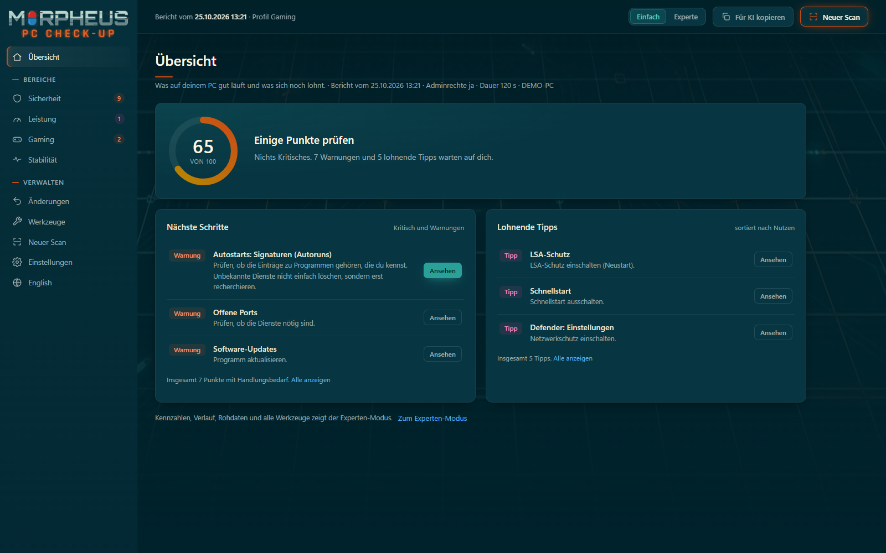

*Alle Screenshots mit Demodaten (Gerät „DEMO-PC“), keine echten Ergebnisse. · All screenshots use demo data (device “DEMO-PC”), no real results.*

---

## Deutsch

Morpheus prüft rund 110 Punkte zu Sicherheit und Leistung eines Windows-11-PCs: Updates, Virenschutz, Firewall, Treiber, Autostart, Hardware, Energie, Gaming-Einstellungen, Audio, Stabilität und Datensicherung. Das Ergebnis ist ein verständlicher Bericht mit Empfehlungen. In der Oberfläche (GUI) lassen sich viele Empfehlungen per Klick umsetzen. Jede Änderung ist durch einen Wiederherstellungspunkt abgesichert und einzeln rückgängig zu machen.

> **Hinweis:** Die Prüfung ändert nichts am System. Die Oberfläche ändert Einstellungen nur nach einem Klick und einer Bestätigung. Vor jeder Änderung wird ein Wiederherstellungspunkt angelegt.

**Inhalt:** [Schnellstart](#schnellstart-in-3-schritten) · [Neu in 2.7](#neu-in-27) · [Features](#features) · [Bedienung](#bedienung) · [Anpassungen per Klick](#anpassungen-per-klick) · [Absicherung](#absicherung-von-%C3%A4nderungen) · [Sicherheit der GUI](#sicherheit-der-gui) · [Daten](#wo-liegen-meine-daten) · [Nur Scan](#nur-scan-ohne-oberfl%C3%A4che) · [Akzeptanzliste](#bewusst-gewollte-befunde-acceptedpsd1) · [Wartung](#wartung--reparatur) · [Programme aktualisieren](#programme-aktualisieren) · [Sysinternals](#sysinternals-werkzeuge) · [Datenschutz](#datenschutz) · [Was geprüft wird](#was-gepr%C3%BCft-wird) · [Versionen](#versionen) · [Deinstallation](#deinstallation)

### Schnellstart in 3 Schritten

1. **Herunterladen und entpacken.** Unter [Releases](https://github.com/oFAILIXo/morpheus-pc-checkup/releases) das ZIP der neuesten Version laden (oder auf GitHub **Code → Download ZIP**). Zuerst **Rechtsklick auf das ZIP → Eigenschaften → unten „Zulassen“ anhaken → OK**, sonst blockiert Windows die Dateien. Dann entpacken, z. B. nach `Dokumente\morpheus-pc-checkup`.
2. **`pc-check-gui.cmd` doppelklicken** und die Adminabfrage (UAC) mit „Ja“ bestätigen. Beim ersten Start fragt Morpheus, ob es nach `C:\Program Files\Morpheus` installiert werden soll. **Enter = Ja.**
3. **Künftig über das Startmenü starten:** „Morpheus – PC Check-up“.

Zeigt Windows „Der Computer wurde durch Windows geschützt“: auf „Weitere Informationen“ → „Trotzdem ausführen“. Das erscheint bei Dateien ohne digitale Signatur.

**Warum installieren?** Die Oberfläche läuft mit Adminrechten. Deshalb muss der Code in einem Ordner liegen, den nur Administratoren ändern können. Ohne Installation oder ohne Adminrechte startet die GUI im **Nur-Lesen-Modus**: Anzeigen ja, Ändern und Scannen nein. Ein Banner nennt den Grund. Liegt schon eine aktuelle Installation vor, startet auch `pc-check-gui.cmd` direkt die installierte Fassung. Bei einer neueren Version bietet Morpheus an, die Installation zu aktualisieren.

Git-Variante:

```bash
git clone https://github.com/oFAILIXo/morpheus-pc-checkup.git
```

**Voraussetzungen:** Windows 11 (Windows 10 funktioniert weitgehend), Windows PowerShell 5.1 (vorinstalliert), Microsoft Edge. Adminrechte werden empfohlen. winget (App-Installer) ist optional für die Update-Prüfung. Nicht aus einer Store-App heraus starten (siehe [Start aus einer Store-App](#start-aus-einer-store-app)).

### Neu in 2.7

- **Ansicht „Einfach“ oder „Experte“:** Der Schalter oben rechts wechselt die Ansicht. „Einfach“ ist Standard und zeigt nur, was zu tun ist.
- **Knopf „KI fragen“** an jedem Befund, jeder Anpassung und jedem Werkzeug. Er kopiert eine fertige Frage für ChatGPT, Gemini, Copilot, Claude oder eine andere KI in die Zwischenablage, persönliche Angaben ersetzt.
- **Farbpaletten:** Solarized, Gruvbox, Oblivion und Sandstone, jeweils dunkel, hell oder wie Windows.
- **Neue Prüfungen:** NVIDIA-Treibereinstellungen im Gaming-Teil und eine neue Kategorie „Audio“, beide nur lesend.
- **Einfacher bedienen:** eine Hauptaktion je Befund, Klartext im Journal („aus → an“), „Neustart ausstehend“ an der Karte, Rückgängig auch bei aktiver 24-Stunden-Sperre, ruhigere Übersicht.
- **Lizenz:** ab 2.7.0 PolyForm Noncommercial 1.0.0 (siehe [Lizenz](#lizenz--license)).

Die vollständige Liste steht unter [Versionen](#versionen).

<table>
  <tr>
    <td align="center">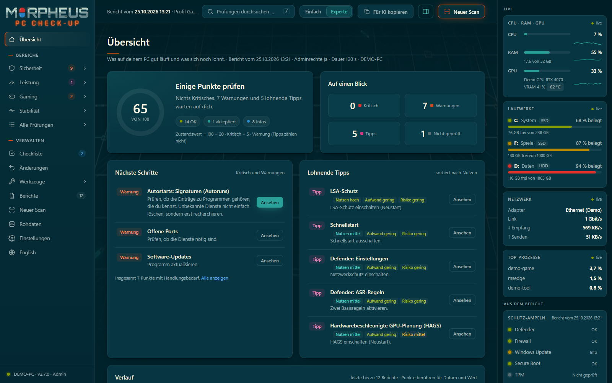<br><sub>Übersicht im Modus „Experte“ mit Live-Statusleiste</sub></td>
    <td align="center"><br><sub>Sicherheit: Befund mit Anpassung und „KI fragen“</sub></td>
  </tr>
  <tr>
    <td align="center"><br><sub>Änderungen mit „Rückgängig“</sub></td>
    <td align="center">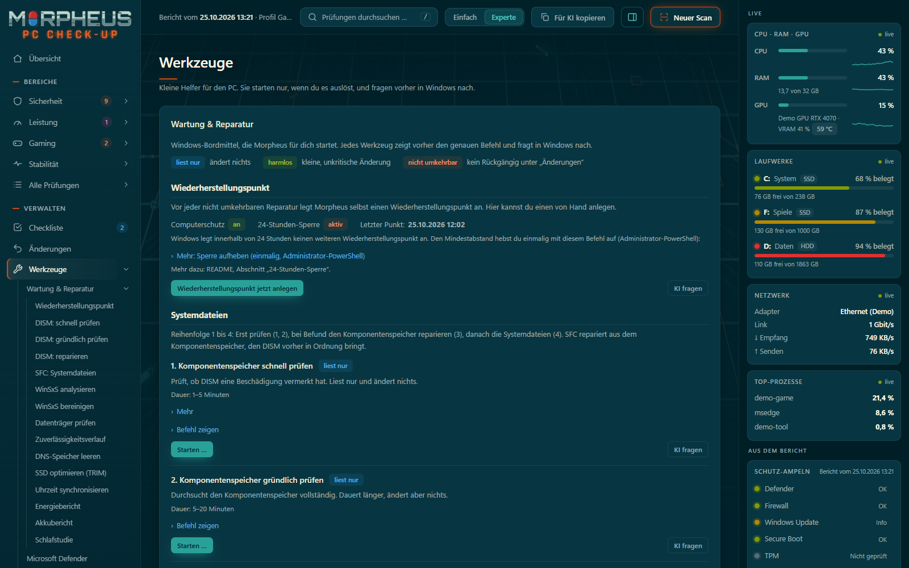<br><sub>Werkzeuge</sub></td>
  </tr>
  <tr>
    <td align="center">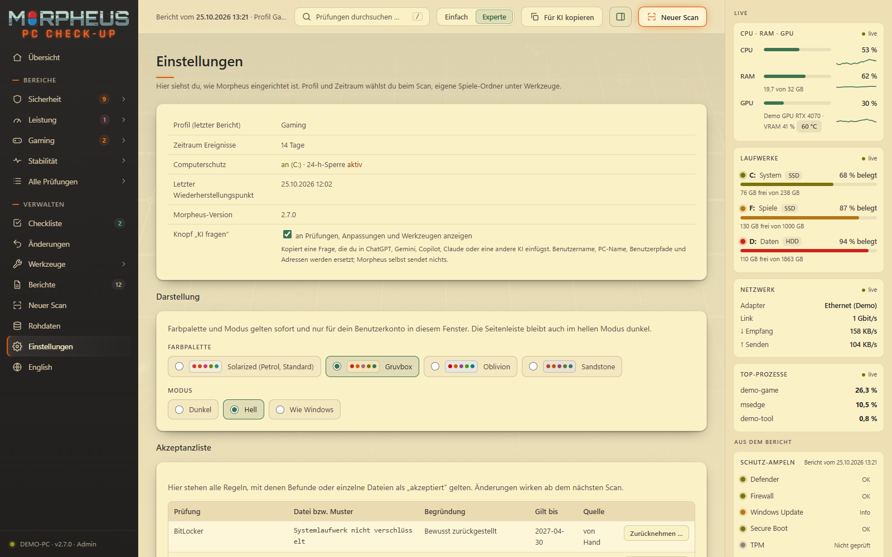<br><sub>Einstellungen › Darstellung (Gruvbox, hell)</sub></td>
    <td align="center">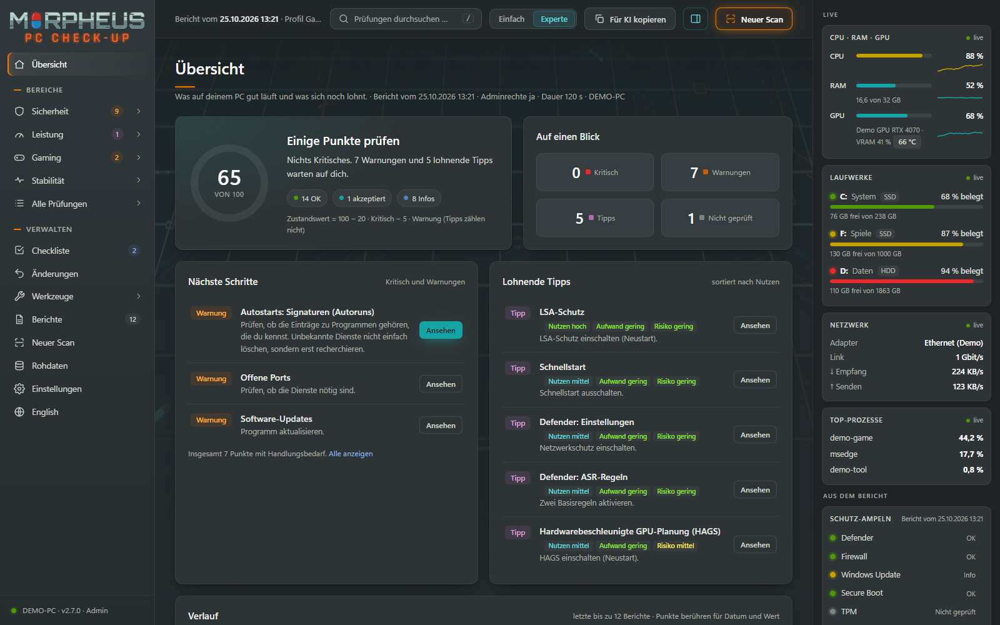<br><sub>Palette Oblivion, dunkel</sub></td>
  </tr>
  <tr>
    <td align="center">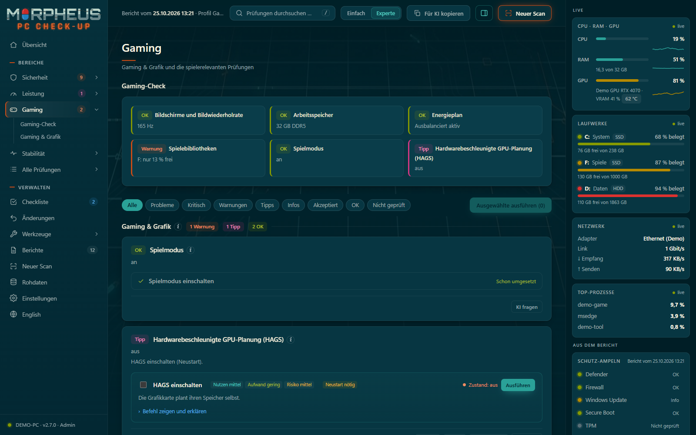<br><sub>Gaming</sub></td>
    <td></td>
  </tr>
</table>

### Features

**Prüfen**
- **Rund 110 Prüfungen** zu Sicherheit und Leistung: Updates, Virenschutz, Firewall, Treiber, Autostart, Hardware, Energie, Audio, Stabilität, Datensicherung. Die Prüfung liest nur.
- **Speicherverbraucher:** die zehn größten Ordner, Dateien und Spiele je Laufwerk. Morpheus löscht nichts.
- **Sysinternals (optional):** Autoruns und Sigcheck prüfen Autostarts und Systemdateien auf Signaturen. Sie werden nur auf deinen Klick geladen.
- **Gaming-Check:** alle spielerelevanten Punkte auf einen Blick, z. B. Bildwiederholrate, HAGS, Spielebibliotheken, installierte Spiele und (ab 2.7) die globalen NVIDIA-Treibereinstellungen.
- **Audio (ab 2.7):** Treiberfehler, Audiodienste, Standardgeräte, USB-Energiesparen und automatische Lautstärkeabsenkung, nur lesend.

**Verstehen**
- **Zustandswert 0–100:** wie gut der PC dasteht. 100 minus 20 je kritischem Befund und minus 5 je Warnung. Tipps senken den Wert nicht (ab 2.7).
- **Erklärungen und Klickwege:** Jede Prüfung hat ein i-Symbol mit Erklärung. „So geht's“ zeigt den Klickweg oder einen Befehl zum Kopieren. Verweise auf Windows-Einstellungen (`ms-settings:…`) sind direkt anklickbar.
- **„KI fragen“ (ab 2.7):** kopiert zu einem Befund, einer Anpassung oder einem Werkzeug eine fertige Frage samt Ergebnis dieses PCs für eine KI deiner Wahl. Persönliches wird ersetzt. Details unter [„KI fragen“](#ki-fragen).
- **„Für KI kopieren“:** kopiert alle Befunde **anonymisiert** (ohne PC-Name, Benutzer, IP- und MAC-Adressen, SIDs und E-Mail-Adressen) in die Zwischenablage. Den Text vor dem Einfügen trotzdem kurz durchlesen.

**Verbessern**
- **17 Anpassungen per Klick:** jede mit Bestätigungsdialog, Befehl zum Nachlesen und Erklärung.
- **Checkliste:** Punkte als „erledigt“ oder „später“ markieren. Der nächste Lauf zeigt, was wirklich behoben ist.
- **Wartung & Reparatur:** DISM, SFC, Komponentenspeicher, chkdsk, DNS leeren, ReTrim, Zeit abgleichen, Energieberichte und Zuverlässigkeitsverlauf, mit festen Befehlen, Windows-Bestätigung und verständlicher Zusammenfassung.
- **Programme aktualisieren:** winget-Updates mit Auswahl, Fortschritt und Ergebnis. winget läuft ohne Adminrechte; Installer mit Adminbedarf fragen selbst über Windows nach.

**Absichern**
- **Wiederherstellungspunkt vor jeder Änderung**, Rückgängig für jede Änderung einzeln, auch bei aktiver 24-Stunden-Sperre (ab 2.7, siehe unten).
- **Änderungsjournal** mit Verlauf aller Anpassungen, in Klartext („aus → an“).
- **Akzeptanzliste** für Befunde, die bewusst so gewollt sind, direkt in der GUI akzeptieren und wieder zurücknehmen.
- **Defender-Werkzeuge:** Signaturen aktualisieren, Schnellscan, Offline-Scan.
- **Datenordner reparieren:** Haben Benutzerkonten zusätzliche Rechte auf den Datenordner bekommen (z. B. per „Fortsetzen“ im Explorer), bietet Morpheus die Reparatur an.

**Überwachen**
- **Live-Statusleiste:** CPU, RAM, GPU mit Temperatur, Laufwerke, Netzwerk und Top-Prozesse, dazu die Schutz-Ampeln aus dem Bericht. Ein- und ausblendbar.
- **Verlauf:** Probleme, Startdauer und freier Platz über die letzten Läufe.
- **Berichtsvergleich:** zwei beliebige Berichte nebeneinander. Geänderte Ergebnisse sowie neue (➕) und verschwundene (➖) Dienste, Treiber, Autostarts, Firewall-Regeln, Programme, Browser-Erweiterungen, Konten und offene Ports fallen auf.

**Anpassen**
- **Deutsch und Englisch:** Oberfläche, Befunde, Erklärungen, Berichte und Konsole.
- **Ansicht „Einfach“ oder „Experte“** und **vier Farbpaletten** in hell und dunkel (ab 2.7).

### Bedienung

| Bereich | Inhalt |
|---|---|
| Übersicht | Zustandswert, nächste Schritte, lohnendste Tipps; im Modus „Experte“ zusätzlich Kennzahlen, Verlauf und Änderungen seit dem letzten Scan |
| Sicherheit | Befunde der Kategorien 1–10, je Befund mit passender Anpassung |
| Leistung | Hardware, Laufwerke und Speicherplatz, Energie, Auslastung, Audio. Ein Klick auf ein Laufwerk zeigt die zehn größten Ordner, Dateien und Spiele |
| Gaming | Gaming-Check und Gaming & Grafik, inkl. NVIDIA-Treibereinstellungen |
| Stabilität | Abstürze, Hardwarefehler, Startdauer |
| Alle Prüfungen | alle Prüfungen nach Bereich und Kategorie (nur „Experte“) |
| Checkliste | Punkte als „erledigt“ oder „später“ markieren (nur „Experte“) |
| Änderungen | Journal mit „↶ Rückgängig“ und Liste der Wiederherstellungspunkte |
| Werkzeuge | Defender (Signaturen, Schnellscan, Offline-Scan mit Countdown, der PC startet neu); Programme aktualisieren (winget); im Modus „Experte“ zusätzlich Wartung & Reparatur, Wiederherstellungspunkt anlegen, Zuverlässigkeitsverlauf, eigene Spiele-Ordner und Sysinternals-Werkzeuge |
| Berichte | alle Läufe, Original-Bericht öffnen, zwei Berichte vergleichen (nur „Experte“) |
| Neuer Scan | Optionen, Start, Live-Protokoll; danach öffnet sich der neue Bericht |
| Rohdaten | Detailtabellen hinter den Prüfungen (nur „Experte“) |
| Einstellungen | Profil, Zeitraum, Knopf „KI fragen“ ein/aus, Darstellung (Farbpalette und hell/dunkel), Akzeptanzliste |

Was im Modus „Einfach“ nicht im Menü steht, bleibt über Links erreichbar. Die Suche liegt oben (nur „Experte“). Mit der Taste `/` springst du direkt dorthin.

#### Ansicht: Einfach oder Experte (ab 2.7)

Der Schalter oben rechts wechselt zwischen zwei Ansichten. Die Wahl gilt je Benutzer.

- **Einfach** (Standard beim ersten Start): Zustandsring mit Klartext, drei nächste Schritte und drei Tipps. In jedem Bereich stehen nur die Befunde, bei denen etwas zu tun ist; alle anderen stehen in einer aufklappbaren Zeile „N weitere Prüfungen ohne Handlungsbedarf“. Unter „Werkzeuge“ gibt es nur Defender und Programm-Updates.
- **Experte:** alle Prüfungen, Filter und Mehrfachauswahl, Rohdaten, Berichte, Checkliste, Statusleiste, Suche und alle Werkzeuge.
- **In beiden Ansichten gleich:** Bestätigungen, Wiederherstellungspunkte, Warnungen, Akzeptieren, „KI fragen“ und Rückgängig.

#### „KI fragen“ (ab 2.7)

Der kleine Knopf „KI fragen“ steht an jedem Befund, jeder Anpassung und jedem Werkzeug. Ein Klick kopiert eine fertige Frage in die Zwischenablage: Was ist das, welche Auswirkungen hat es, wie kritisch ist es (unbedenklich bis dringend), welchen Nutzen und welche Nachteile hat eine Änderung, und was kann ein Einsteiger selbst tun. Mit `Strg+V` fügst du sie in ChatGPT, Gemini, Copilot, Claude oder eine andere KI ein.

- Das Ergebnis dieses PCs kommt mit. **PC-Name, Benutzername, Benutzerpfade, E-Mail-Adressen, SIDs, MAC- und IP-Adressen werden durch Platzhalter ersetzt.**
- **Schutz gegen untergeschobene Anweisungen:** Werte vom PC (z. B. der Name eines Autostart-Eintrags) stehen in einem Datenblock mit zufälliger Markierung, und die KI wird angewiesen, ihn nur als Daten zu lesen. Steuer- und Richtungszeichen werden entfernt, die Länge ist begrenzt.
- **Morpheus selbst sendet nichts.** Es kopiert nur Text; was du einfügst, entscheidest du.
- Unter Einstellungen lässt sich der Knopf ausblenden.

#### Farbpaletten (ab 2.7)

Unter **Einstellungen › Darstellung** wählst du die Farbpalette (Solarized als Standard, Gruvbox, Oblivion, Sandstone) und den Modus (Dunkel, Hell, Wie Windows). Die Wahl gilt sofort und je Benutzer. Die Seitenleiste bleibt auch im hellen Modus dunkel.

#### Menü

Jeder Bereich mit einem Pfeil `›` klappt seine Unterpunkte auf: Sicherheit, Leistung, Gaming und Stabilität ihre Kategorien, „Alle Prüfungen“ die Status-Filter, „Werkzeuge“ die Karten und unter „Wartung & Reparatur“ jedes einzelne Werkzeug. Ein Klick springt direkt dorthin. Mit der Tastatur: Pfeil hoch/runter wechselt den Eintrag, Pfeil rechts klappt auf bzw. geht zum ersten Unterpunkt, Pfeil links klappt zu bzw. geht zurück zum Bereich, Enter öffnet. Im Modus „Einfach“ hat das Menü keine Unterpunkte.

#### Sprache

Morpheus gibt es auf Deutsch und Englisch: Oberfläche, Befunde, Erklärungen, Berichte und Konsole. Beim ersten Start gilt die Sprache von Windows (Deutsch bei deutschem Windows, sonst Englisch). Umschalten geht im Menü unter „Verwalten“. Die Wahl wird in `C:\ProgramData\Morpheus\state\sprache.json` gespeichert und gilt auch für den Scan über `pc-check.cmd`. Ein Bericht bleibt in der Sprache, die beim Scan eingestellt war. Akzeptierte Befunde gelten in beiden Sprachen.

#### Typische Abläufe

**Anpassung ausführen:** Die Karte bei einem Befund zeigt die Anpassung. „▸ Befehl zeigen und erklären“ zeigt den PowerShell-Befehl samt Erklärung. Dann „Ausführen“, im Dialog bestätigen und zum Schluss im Windows-Fenster „Morpheus – Änderung bestätigen“ auf „Ja“ klicken. Im Modus „Experte“ lassen sich mehrere Anpassungen gemeinsam ausführen. Ist das Ziel schon erreicht, steht dort „Schon umgesetzt“. Braucht die Anpassung einen Neustart, zeigt die Karte bis dahin „Ausgeführt – Neustart ausstehend“.

**Befund-Karte:** Jeder Befund hat eine Hauptaktion. Erledigt, Später, Akzeptieren und „Daten ansehen“ stehen in der Fußzeile; „Daten ansehen“ springt zur passenden Detailtabelle.

**Anpassung zurücknehmen:** Im Bereich **Änderungen** den Eintrag mit „↶ Rückgängig“ wählen. Das Journal zeigt die Werte in Klartext, z. B. „aus → an“. Hat sich der Zustand inzwischen anders geändert, fragt die GUI nach.

**Berichte vergleichen:** Im Bereich **Berichte** zwei Zeilen ankreuzen und „Vergleichen“ wählen. Mit „Original-HTML“ öffnest du den unveränderten Bericht.

**Speicher-Fenster:** Fährst du mit der Maus über ein Laufwerk der Karte „Laufwerke“ (oder klickst es an bzw. drückst Enter), zeigt ein Fenster die zehn größten Ordner, Dateien und Spiele. Grundlage ist der Stand aus dem letzten Scan oder aus „Neu berechnen“; das Datum steht im Fenster. Ein Klick auf einen Eintrag kopiert den Pfad. Morpheus löscht nichts. Systemdateien wie `pagefile.sys` sind mit „Windows“ gekennzeichnet.

**Defender-Werkzeuge:** Unter **Werkzeuge** aktualisierst du die Defender-Signaturen, startest einen Schnellscan oder einen Offline-Scan. Der Offline-Scan braucht eine doppelte Bestätigung und einen 15-Sekunden-Countdown, danach startet der PC neu. Zusätzlich gibt es einen Knopf direkt am Defender-Befund.

**Neuer Scan:** Im Bereich **Neuer Scan** die Optionen wählen und starten. Das Live-Protokoll zeigt den Fortschritt. Danach öffnet sich der neue Bericht.

**Den Bericht lesen:** Status je Prüfung: **Kritisch**, **Warnung**, **Tipp**, **Akzeptiert**, **Hinweis**, **OK**, **Nicht geprüft**. Ein Klick auf eine Zahl bei der Ampel filtert nach diesem Status. Tipps sind nach Nutzen im Verhältnis zu Aufwand und Risiko sortiert. Reine Informationen bleiben „Hinweis“.

**Statusleiste:** Die rechte Statusleiste (ein- und ausblendbar) zeigt Live-Werte für CPU, RAM und GPU (inkl. Temperatur), Laufwerke, Netzwerk und Top-Prozesse. Darunter steht der Status aus dem Bericht: Schutz-Ampeln, offene Ports, Stabilität und Absicherung. Die Live-Werte sammelt der Server nur, solange die Oberfläche sie abfragt.

### Anpassungen per Klick

Die Karten mit einer Anpassung erscheinen direkt beim passenden Befund.

| Bereich | Anpassung | Neustart nötig |
|---|---|---|
| Sicherheit | Defender-Netzwerkschutz an | Nein |
| Sicherheit | Schutz vor potenziell unerwünschten Apps an | Nein |
| Sicherheit | ASR-Regeln für anfällige Treiber und LSASS-Diebstahl: blockieren oder nur protokollieren | Nein |
| Sicherheit | Remoteunterstützung aus | Nein |
| Sicherheit | Remotedesktop aus | Nein |
| Sicherheit | LLMNR aus | Nein |
| Sicherheit | Computerschutz (Wiederherstellungspunkte) einschalten | Nein |
| Sicherheit | Speicher für Wiederherstellungspunkte auf 10 % vergrößern | Nein |
| Sicherheit | LSA-Schutz an | Ja |
| Sicherheit | Sperrliste anfälliger Treiber an | Ja |
| Leistung | Schnellstart aus | Nein |
| Leistung | PCIe-Energieverwaltung (ASPM) aus | Nein |
| Gaming | Spielmodus an | Nein |
| Gaming | Hardwarebeschleunigte GPU-Planung an | Ja |
| Gaming | Hintergrundaufnahme (Game DVR) aus | Nein |
| Gaming | Mausbeschleunigung aus (wirkt nach Ab- und Anmelden) | Nein |
| Gaming | Energiesparfunktionen der Netzwerkkarte aus (Verbindung ist kurz weg) | Nein |

Neu gestartet wird nie automatisch. Bei Anpassungen mit Neustart zeigt die GUI einen Hinweis.

**Speicher für Wiederherstellungspunkte und „Point-in-time restore“:** Ist unter Windows 11 „Point-in-time restore“ aktiv, setzt Windows die Speichergrenze bei jedem Start auf dessen Einstellung zurück. Morpheus ändert dann nichts und zeigt einen Hinweis mit anklickbarem Link zu den Einstellungen (`ms-settings:recovery`): Einstellungen › System › Wiederherstellung › Point-in-time restore, höchstens 50 GB. Nach einem Neustart den Scan erneut ausführen.

**Nicht per Klick:** BIOS, Secure Boot, BitLocker, Treiber, Löschen, Konten und Firewall-Regeln gibt es nur als Anleitung. Sie lassen sich nicht sauber zurücknehmen.

### Absicherung von Änderungen

Jede Anpassung läuft in festen Schritten:

1. Aktuellen Zustand lesen.
2. Voraussetzungen prüfen.
3. Wiederherstellungspunkt anlegen und prüfen. Fehlt er, wird nichts geändert. Die Punkte heißen „Morpheus: …“.
4. Eintrag im Änderungsjournal schreiben.
5. Änderung ausführen.
6. Kontrolle. Klappt sie nicht, wird sofort zurückgesetzt.

**Rückgängig:** Jede Änderung lässt sich einzeln zurücknehmen und bekommt dafür einen eigenen Wiederherstellungspunkt. Rückgängig stellt exakt den alten Zustand her, auch wenn ein Wert vorher nicht existierte.

**Alles zurück:** `rstrui.exe` startet die Systemwiederherstellung. Sie setzt auch Programme und Treiber zurück, die danach installiert wurden.

#### 24-Stunden-Sperre

Windows legt standardmäßig höchstens einen Wiederherstellungspunkt pro 24 Stunden an. Diese Sperre ist auf fast jedem PC aktiv.

- **Ausführen:** Der Dialog erklärt die Sperre vorher. Deutlich hervorgehoben wird der Hinweis erst, wenn Morpheus in den letzten 24 Stunden selbst einen Punkt angelegt hat. Entsteht kein neuer Punkt, lehnt Morpheus die Änderung ab.
- **Rückgängig (ab 2.7):** Ist kein neuer Punkt möglich, sichert der Punkt ab, der beim Ausführen entstanden ist, sofern er noch unverändert vorhanden ist. Er hält genau den Zustand fest, zu dem Rückgängig zurückkehrt. Fehlt er, bricht Rückgängig ab, und der Dialog nennt den Ausweg.
- **Sperre aufheben:** Der Befehl steht in Morpheus aufklappbar unter „Mehr: Sperre aufheben (einmalig, Administrator-PowerShell)“. Du führst ihn selbst in einer Administrator-PowerShell aus:

```powershell
New-ItemProperty -Path 'HKLM:\SOFTWARE\Microsoft\Windows NT\CurrentVersion\SystemRestore' -Name SystemRestorePointCreationFrequency -PropertyType DWord -Value 0 -Force
```

Rückgängig machen:

```powershell
Remove-ItemProperty -Path 'HKLM:\SOFTWARE\Microsoft\Windows NT\CurrentVersion\SystemRestore' -Name SystemRestorePointCreationFrequency
```

Die GUI ändert diese Einstellung bewusst nicht selbst. Unter Werkzeuge › Wartung & Reparatur legt „Wiederherstellungspunkt jetzt anlegen“ einen Punkt von Hand an.

**Ausnahme:** „Computerschutz einschalten“ läuft ohne Wiederherstellungspunkt, weil vorher keiner entstehen kann. Achtung: Dessen Rückgängig schaltet den Schutz aus und löscht alle Wiederherstellungspunkte.

### Sicherheit der GUI

Die GUI läuft mit Adminrechten. Deshalb gelten strenge Regeln:

- Der Server hört nur auf `127.0.0.1`.
- Edge bekommt nur einen Einmal-Code. Die Oberfläche tauscht ihn gegen das zufällige Sitzungstoken. Das Token steht nie in einer Befehlszeile, Adresse oder einem Protokoll.
- Host und Herkunft jeder Anfrage werden geprüft. Änderungen sind nur per POST mit JSON möglich.
- Die Oberfläche kann nur feste Aktionen aus dem Katalog auslösen, keine beliebigen Befehle.
- Original-Berichte laufen im abgeschotteten Rahmen mit einmaliger Lesemarke.
- Der Code liegt unter `C:\Program Files\Morpheus`, die Daten unter `C:\ProgramData\Morpheus`. Beides können nur Administratoren ändern.
- Auch was Morpheus nachlädt, kommt nur aus Ordnern, die nur Administratoren ändern können: PowerShell-Module nur aus `C:\Windows\System32` und `C:\Program Files`, Windows-Programme mit vollem Pfad, winget nur aus dem signierten App-Installationsprogramm, temporäre Dateien unter `C:\ProgramData\Morpheus\temp`.
- Wartungswerkzeuge und Programm-Updates laufen nur aus einem festen Katalog mit festen Programmpfaden. Die Oberfläche schickt nur eine Werkzeug-Id, ein Laufwerk aus der vom Server ermittelten Liste oder Paket-Ids aus der zuletzt vom Server gesuchten Liste.
- **Jede Änderung und jedes Rückgängig bestätigt zusätzlich ein Windows-Dialog** („Morpheus – Änderung bestätigen“). Er gehört zum Prozess mit Adminrechten; Windows verhindert, dass Programme ohne Adminrechte darin klicken oder tippen. So kann auch ein Schadprogramm, das das Morpheus-Fenster fernsteuert, nichts ändern. „Nein“ ist vorbelegt.
- Links aus Befunden öffnen nur Windows-Einstellungen (`ms-settings:…`) nach festem Muster, keine anderen Adressen.
- Die Daten unter `C:\ProgramData\Morpheus` können nur Administratoren lesen und ändern. Berichte enthalten Programme, Konten und Netzwerkdetails; auch andere Benutzerkonten des PCs sehen sie nicht. Ansehen kannst du sie in Morpheus unter „Berichte“.
- **Den Ordner `C:\ProgramData\Morpheus` nicht im Explorer über „Fortsetzen“ öffnen.** Der Explorer trägt dabei dauerhaft Vollzugriff für dein Konto ein. Dann könnte jedes Programm, das unter deinem Konto läuft, Journal, Akzeptanzliste und Zwischendateien ändern. Morpheus erkennt das beim nächsten Start und bietet an, die Rechte zu reparieren (Banner „Die Rechte des Datenordners wurden geändert“, Knopf „Rechte reparieren …“, nach Windows-Bestätigung). Danach Morpheus neu starten und unter „Änderungen“ sowie „Einstellungen › Akzeptanzliste“ prüfen, ob alle Einträge von dir stammen. Zum Ansehen eine PowerShell als Administrator öffnen, z. B. `Get-ChildItem C:\ProgramData\Morpheus\reports`. Von Hand reparieren in einer Admin-PowerShell:
  ```powershell
  icacls C:\ProgramData\Morpheus /remove:g "*$([Security.Principal.WindowsIdentity]::GetCurrent().User.Value)" /T /C
  ```
- Der Server endet mit dem Fenster. Läuft noch ein Werkzeug, wartet er, bis es fertig ist.

Aufbau und Sicherheitsmodell im Detail: `docs/gui-architektur.md`.

#### Datenordner reparieren

- **Wann:** Nur wenn Benutzerkonten zusätzliche Rechte auf `C:\ProgramData\Morpheus` haben. Bei fremdem Besitzer oder Verknüpfungen im Ordner legt Morpheus den Ordner beiseite.
- **Was passiert:** Morpheus entfernt die zusätzlichen Rechte (nach Windows-Bestätigung). `temp` und `tools` werden neu angelegt, `tools` wird bei Bedarf neu geladen (Sysinternals).
- Journal, Akzeptanzliste und Checkliste bleiben erhalten und werden neu geschrieben. Berichte bleiben unverändert.
- **Stattdessen neu anlegen:** Der alte Ordner wird als `Morpheus.unsicher-<Datum>` beiseitegelegt, danach entsteht ein leerer Ordner.
- **Rückgängig:** Für ältere Journal-Einträge gibt es das nur mit einer Zusatzbestätigung. Prüfe vorher, ob du die Änderung selbst vorgenommen hast.
- Danach Morpheus neu starten.

### Wo liegen meine Daten?

| Was | Installierte Fassung | Ohne Installation (Nur-Lesen) |
|---|---|---|
| Programm | `C:\Program Files\Morpheus` | Ordner, aus dem du startest |
| Berichte | `C:\ProgramData\Morpheus\reports\` | Ordner `reports\` neben dem Script |
| Änderungsjournal | `C:\ProgramData\Morpheus\changes\journal.json` | wie links, Ändern gesperrt |
| Checkliste | `C:\ProgramData\Morpheus\state\checklist.json` | wie links |
| Akzeptanzliste | `C:\ProgramData\Morpheus\accepted.psd1` | wie links |
| Sprache | `C:\ProgramData\Morpheus\state\sprache.json` | wie links |
| Sysinternals-Werkzeuge | `C:\ProgramData\Morpheus\tools` | nicht verfügbar |
| Eigene Spiele-Ordner | `C:\ProgramData\Morpheus\state\spielordner.json` | wie links |
| Protokoll | `C:\ProgramData\Morpheus\state\gui.log` | wie links |
| Ansicht, Farbpalette, „KI fragen“ ein/aus | im Browserspeicher des Morpheus-Fensters, je Benutzer | wie links |

Den Ordner können nur Administratoren lesen und ändern; Berichte siehst du in Morpheus unter „Berichte“. Vorhandene Berichte und die `accepted.psd1` übernimmt die Installation einmalig.

### Nur Scan (ohne Oberfläche)

Gibt es eine aktuelle Installation unter `C:\Program Files\Morpheus`, startet `pc-check.cmd` den Scan aus dieser installierten Fassung. So bekommt Code aus einem Ordner, den auch Programme ohne Adminrechte ändern können, keine Adminrechte.

1. **Doppelklick auf `pc-check.cmd`** und die Adminabfrage (UAC) mit „Ja“ bestätigen. Zeigt Windows „Der Computer wurde durch Windows geschützt“: **Weitere Informationen → Trotzdem ausführen**.
2. Der Lauf dauert etwa 4–6 Minuten.
3. Am Ende fragt das Script, ob verfügbare Programm-Updates installiert werden sollen (`1,3`, `a` für alle, **Enter für keine**).
4. Der **Bericht öffnet sich automatisch im Browser**. Er liegt im Unterordner `reports\` als `pc-check_<Datum>.html`, zusätzlich als `.md` (Text) und `.json` (für den Vergleich mit dem nächsten Lauf).

Alternativ in einer **Administrator-PowerShell** im Ordner:

```powershell
powershell.exe -NoProfile -ExecutionPolicy Bypass -File .\pc-check.ps1
```

`-ExecutionPolicy Bypass` gilt nur für diesen Aufruf und ändert keine Einstellung. Ohne Adminrechte läuft das Script auch, lässt aber einige Prüfungen aus (BitLocker, TPM, Sicherheitsprotokoll …). Die Dateien heißen aus Kompatibilitätsgründen weiterhin `pc-check.*`.

| Parameter | Bedeutung |
|---|---|
| `-EventDays 30` | Ereignisprotokolle der letzten 30 statt 14 Tage auswerten (1–90) |
| `-OutputDir <Pfad>` | Bericht woanders ablegen |
| `-SkipUpdateSearch` | keine Online-Suche nach ausstehenden Windows-Updates |
| `-SkipWinget` | keine Prüfung auf Software-Updates per winget |
| `-SkipSpeicher` | keine Auswertung der größten Speicherverbraucher (spart 1–3 Minuten) |
| `-SkipSysinternals` | Autoruns und Sigcheck nicht verwenden |
| `-SpielOrdnerFile <Pfad>` | Datei mit eigenen Spiele-Ordnern (Standard: `state\spielordner.json` im Datenordner) |
| `-NoUpdatePrompt` | keine Nachfrage nach Programm-Updates am Ende (rein lesender Lauf) |
| `-CompareWith <Pfad>` | mit diesem Bericht vergleichen statt mit dem jüngsten in `reports\` |
| `-AcceptedFile <Pfad>` | andere Akzeptanzliste verwenden |
| `-NoOpen` | HTML-Bericht am Ende nicht automatisch im Browser öffnen |
| `-Profil Gaming` | Empfehlungen für `Gaming`, `Office` oder `Laptop` gewichten (Standard: automatisch, Laptop bei Akku, Gaming bei eigener Grafikkarte) |

#### Der Bericht (HTML)

- **Ampel** mit Gesamteinschätzung und **den nächsten Schritten**, darunter die **lohnendsten Tipps**.
- **Tipps mit Nutzen, Aufwand und Risiko**, sortiert nach Nutzen im Verhältnis zu Aufwand und Risiko.
- **„So geht's“** an Warnungen und Tipps: der Klickweg durch die Einstellungen, oft mit einem Befehl zum Kopieren; Links zu Windows-Einstellungen sind anklickbar.
- **Meine Checkliste**, **Gaming-Check**, **Verlauf** als kleine Diagramme, **Filter und Suche**, **i-Symbol** mit Erklärung an jeder Prüfung.
- **Bekannt harmlose Ereignisse** ordnet Morpheus selbst ein (z. B. Dienstfehler entfernter Programme, Routine-Kontoänderungen durch Windows).
- **Änderungen seit dem letzten Lauf**, **alle Prüfungen** mit aufklappbaren **Rohdaten**, **„So liest du den Bericht“** und **„Für KI-Assistent kopieren“** (anonymisiert).

Die Datei ist eigenständig und funktioniert ohne Internet.

#### Update-Dialog am Ende

Gilt für den reinen Scan in der Konsole (`pc-check.cmd`); in der GUI geht das unter Werkzeuge › Programme aktualisieren. Nach dem fertigen Bericht listet das Script verfügbare **Programm**-Updates nummeriert auf und fragt, welche installiert werden sollen (`1,3`, `a` für alle, Enter für keine).

- winget lädt die Updates aus den Herstellerquellen und **akzeptiert dabei die Lizenzbedingungen der Pakete**.
- Nicht angeboten werden Spiele und Launcher, Programme mit eigener Update-Funktion (Edge, Teams, Outlook, VS Code, Autodesk Fusion) und Einträge, die winget kennt, Windows aber nicht mehr als installiert führt.
- winget läuft ohne Adminrechte; Installer mit Adminbedarf fragen selbst über Windows nach.
- Bricht ein Installer ab, weil das Programm noch läuft, bietet der Dialog nach dem Schließen einen zweiten Versuch an.
- Das Ergebnis wird als Abschnitt „Updates nach dem Lauf“ an den Bericht angehängt.

### Bewusst gewollte Befunde (`accepted.psd1`)

Manches ist auf deinem PC absichtlich so, z. B. ein genutztes Fernwartungsprogramm. Damit es nicht bei jedem Lauf als Warnung erscheint:

- **In der GUI:**
  - Am Befund „Akzeptieren …“ wählen und eine Begründung eingeben, optional ein Ablaufdatum. Die Regel gilt genau für den aktuellen Befund-Text.
  - Unsignierte Systemdateien (Sigcheck) akzeptierst du einzeln unter „Daten ansehen“. Die Regel ist an den SHA256 der Datei gebunden: Ändert sich die Datei, kommt die Warnung zurück.
  - Gespeichert wird erst nach dem Windows-Bestätigungsdialog.
  - Unter Einstellungen › Akzeptanzliste nimmst du Regeln wieder zurück.
  - Es wirkt ab dem nächsten Scan.
- **Von Hand:**
  1. `accepted.example.psd1` nach `accepted.psd1` kopieren (installiert: `C:\ProgramData\Morpheus`, als Administrator bearbeiten).
  2. Einträge nach dem Beispiel ergänzen; den Befund-Text aus dem eigenen Bericht übernehmen.
  - Schreibt die GUI die Datei, bleiben deine Regeln erhalten, Kommentare aber nicht. Die vorige Fassung liegt dann als `accepted.psd1.bak` daneben.

Passende Befunde erscheinen dann als „Akzeptiert“ und zählen nicht in den Zustandswert. Ein enges Muster (`Match`) sorgt dafür, dass die Warnung zurückkehrt, sobald sich etwas ändert. Mit `Until` meldet sich ein Punkt nach einem Datum wieder. `accepted.psd1` ist per `.gitignore` vom Repo ausgeschlossen.

### Wartung & Reparatur

Unter **Werkzeuge › Wartung & Reparatur** (Modus „Experte“) startet Morpheus Windows-eigene Werkzeuge mit festen Befehlen. Jedes Werkzeug zeigt den genauen Befehl, läuft im Hintergrund mit Live-Ausgabe und fragt vorher im Windows-Dialog nach. Es gibt drei Klassen:

| Klasse | Bedeutung | Werkzeuge |
|---|---|---|
| liest nur | ändert nichts | DISM `/CheckHealth`, `/ScanHealth`, `/AnalyzeComponentStore`; `chkdsk C: /scan` (Laufwerk wählbar); `powercfg /energy`, `/batteryreport`, `/sleepstudy` |
| harmlos | kleine Wartung ohne Risiko | Wiederherstellungspunkt anlegen; `ipconfig /flushdns`; ReTrim für SSDs (`defrag C: /L`, dasselbe wie `Optimize-Volume -ReTrim`); `w32tm /resync` |
| nicht umkehrbar | Reparatur bzw. Bereinigung | DISM `/RestoreHealth` (braucht Internet), `sfc /scannow`, DISM `/StartComponentCleanup` |

- **Nicht umkehrbar heißt:** Unter „Änderungen“ gibt es dafür kein „Rückgängig“. Vorher legt Morpheus automatisch einen Wiederherstellungspunkt an und prüft ihn. Klappt das nicht (z. B. 24-Stunden-Sperre), startet nichts. Erst nach einer ausdrücklichen Zusatzbestätigung geht es ohne Punkt weiter; der Windows-Dialog sagt das dann deutlich.
- **Reihenfolge bei Systemdateien:** 1. CheckHealth, 2. ScanHealth, 3. RestoreHealth, 4. `sfc /scannow`. SFC repariert aus dem Komponentenspeicher, den DISM vorher in Ordnung bringt.
- **Komponentenspeicher:** Morpheus verwendet kein `/ResetBase` (das macht installierte Updates dauerhaft). Den Ordner `WinSxS` nie von Hand löschen.
- **Abbrechen** geht bei lesenden Werkzeugen, chkdsk, ReTrim und dem Energiebericht. DISM-Reparatur, Bereinigung und SFC sollte man nicht unterbrechen; dort gibt es keinen Abbruch-Knopf.
- **Ergebnis:** Morpheus fasst die Ausgabe verständlich zusammen (deutsche und englische Windows-Ausgaben) und schreibt ein Protokoll mit Befehl, Dauer, Exit-Code und Kurzfassung ins Änderungsjournal.
- **Energieberichte** landen in `C:\ProgramData\Morpheus\reports` und öffnen sich in Morpheus im abgeschotteten Rahmen.
- **Zuverlässigkeitsverlauf** (`perfmon /rel`) öffnet sich ohne Adminrechte. Klappt das nicht: `Win + R`, `perfmon /rel`.
- Bewusst nicht dabei (erst später bzw. nur als Anleitung): `chkdsk /f`, Speichertest, Windows Update zurücksetzen, alte Treiber entfernen, Netzwerk-Reset.

### Programme aktualisieren

Unter **Werkzeuge › Programme aktualisieren** sucht Morpheus mit winget nach Updates, du wählst die Programme aus, und Morpheus installiert sie mit Fortschritt und Ergebnis je Programm.

- Vorher entsteht ein Wiederherstellungspunkt. **Programm-Updates lassen sich nicht über „Änderungen“ zurücknehmen**; im Journal steht je Programm ein Protokoll.
- Angeboten werden nur Programme aus der zuletzt in Morpheus gesuchten Liste (gleiche Regeln wie im Update-Dialog der Konsole).
- „Abbrechen“ hört nach dem gerade laufenden Programm auf.
- **winget läuft ohne Adminrechte,** bei der Suche und bei den Updates. Morpheus startet winget über eine kurzlebige geplante Aufgabe unter deinem Konto mit dem normalen Benutzer-Token (wie ein Programm aus dem Startmenü). Die Aufgabe wird nach jedem Programm wieder gelöscht. Braucht ein Installer Adminrechte, fragt Windows selbst nach (Benutzerkontensteuerung). **Dort den Herausgeber prüfen**: Steht „Unbekannt“ oder ein unerwarteter Name da, „Nein“ wählen. Lehnst du ab, meldet Morpheus das Programm als „nicht aktualisiert“.
- Morpheus startet winget nur aus dem signierten App-Installer-Paket unter `C:\Program Files\WindowsApps`, nie über den Suchpfad. Das gilt auch für den Scan.

### Sysinternals-Werkzeuge

Morpheus kann zwei kostenlose Werkzeuge von Microsoft Sysinternals nutzen: **Autoruns** (alle Autostarts: Dienste, Treiber, geplante Aufgaben, Anmeldung, Explorer) und **Sigcheck** (Signaturen der Dateien in `System32` und `System32\drivers`). Sie sind nicht enthalten, sondern werden nur auf deinen Klick geladen:

1. Morpheus › **Werkzeuge** › Karte „Sysinternals (Microsoft)“ › **Herunterladen …** (Modus „Experte“)
2. Lizenzbedingungen lesen (Link) und das Häkchen setzen. Die Zustimmung wird gespeichert.
3. Im Windows-Dialog bestätigen.

- **Quelle:** nur `https://download.sysinternals.com/files/Autoruns.zip` und `Sigcheck.zip` (zusammen ca. 4 MB). Das ist die einzige Verbindung. Einen VirusTotal-Abgleich gibt es nicht, es verlassen also keine Daten den PC.
- **Ablage:** `C:\ProgramData\Morpheus\tools` (nur Administratoren). Entpackt werden nur `autorunsc64.exe`, `sigcheck64.exe` und der Lizenztext.
- **Vor jedem Start** prüft Morpheus: Ordner und Datei nur für Administratoren änderbar, Datei unverändert seit dem Download (SHA256), gültige Signatur von Microsoft Corporation mit Microsoft-Stammzertifikat, Versionsinfo „Sysinternals“. Während des Laufs ist die Datei gegen Austausch gesperrt. Schlägt eine Prüfung fehl, startet das Werkzeug nicht, und der Scan meldet es.
- **Im Scan:** Prüfungen „Autostarts: Signaturen (Autoruns)“, „Autostarts: beschreibbare Pfade (Autoruns)“ und „Systemdateien: Signaturen (Sigcheck)“, je mit Tabelle unter „Daten ansehen“. Ohne eingerichtete Werkzeuge oder ohne Adminrechte werden sie übersprungen. Abschalten mit `-SkipSysinternals` bzw. dem Häkchen unter „Neuer Scan“.
- **Prüfhilfe:** Bei unsignierten Systemdateien gibt es je Datei „Mit Defender prüfen“, einen VirusTotal-Link und „Hash kopieren“.
- **Entfernen:** Werkzeuge › „Entfernen …“ löscht die Dateien und nimmt die Zustimmung zurück.

### Start aus einer Store-App

Store-Apps (MSIX) virtualisieren Teile der Registry (`HKCU`) für alle Prozesse, die sie starten, auch mit Adminrechten. Wird Morpheus aus so einer App heraus gestartet, können Ergebnisse unter `HKCU` abweichen. Die Prüfung „Ausführungsumgebung“ warnt dann. Am besten per Doppelklick auf `pc-check-gui.cmd` oder `pc-check.cmd` bzw. aus einem normalen PowerShell-Fenster starten.

### Datenschutz

- Alles läuft **lokal**. Es werden keine Daten an den Autor oder Dritte geschickt.
- Netzwerkzugriffe gibt es nur für die Windows-Update-Suche, winget und die UPnP-Abfrage am eigenen Router, sowie auf deinen Klick für Sysinternals, DISM `/RestoreHealth` (Windows Update) und den Zeitabgleich (`w32tm /resync`).
- „KI fragen“ und „Für KI kopieren“ legen nur Text in die Zwischenablage. Persönliches wird ersetzt. Den Text vor dem Einfügen trotzdem kurz durchlesen.
- Der Bericht enthält viele Details deines PCs (Programme, Konten, Netzwerk, Treiber). Er bleibt lokal und ist per `.gitignore` ausgeschlossen. **Nicht unbedacht weitergeben oder hochladen.**

### Was geprüft wird

**Sicherheit:** Windows-Version und Updates, Defender (Status, Einstellungen, ASR-Regeln, Ausnahmen, Funde), Firewall und offene Ports, UPnP-Weiterleitungen am Router, SMB/Freigaben, Konten und Kennwortrichtlinie, UAC, Kernisolierung/Speicherintegrität, LSA-Schutz, Treiber-Sperrliste, Exploit-Schutz, Spectre-Tweaks, Secure Boot (inkl. 2023er-Zertifikate), TPM, BitLocker, BIOS, Datensicherung (Dateiversionsverlauf, OneDrive-Ordnersicherung, Systemabbild), Wiederherstellungspunkte, Fernzugriff (RDP, Fernwartungstools), Drittanbieter-Dienste und -Treiber (inkl. bekannt anfälliger Treiber), Dienstpfade, Autostart (mit Sysinternals Autoruns zusätzlich alle Autostart-Orte, Signaturen und beschreibbare Pfade), unsignierte Systemdateien (Sysinternals Sigcheck), geplante Aufgaben, WMI-Persistenz, Browser-Erweiterungen, veraltete Software, sicherheitsrelevante Ereignisse.

**Performance:** CPU, RAM (XMP, Dual-Channel), GPU-Treiber, Bildwiederholrate der Monitore, Laufwerke (Typ, Zustand, Platz, TRIM), größte Speicherverbraucher je Laufwerk, Auslagerungsdatei, Energieplan, Gaming-Einstellungen (Spielmodus, HAGS, Game DVR, Overlays), NVIDIA-Treibereinstellungen (Shader-Cache, Energieverwaltung, V-Sync, max. Bildrate, G-SYNC), Resizable BAR und PCIe-Anbindung (NVIDIA), Spielebibliotheken, installierte Spiele (Steam, Epic, GOG, EA, Ubisoft, Xbox), Energiesparfunktionen der Netzwerkkarte, Audio (Treiberfehler, Dienste, Standardgeräte, USB-Energiesparen, Ducking), Grundlast, Autostart-Umfang, Netzwerk, Stabilität (Hardwarefehler, Bluescreens, Grafiktreiber-Abstürze, Drosselung, Programmabstürze, Startdauer).

### Nebenwirkungen (nicht am System)

- `secedit` exportiert die Sicherheitsrichtlinie in eine Temp-Datei, die sofort gelöscht wird.
- `Add-Type` kompiliert kleine Hilfsklassen zum Auslesen der Bildwiederholraten und der NVIDIA-Treibereinstellungen (nur lesend, `nvapi64.dll` nur aus System32 nach Signaturprüfung).
- Windows-Update-Suche, winget und die UPnP-Abfrage gehen ins Netz bzw. zum Router. Der Scan selbst lädt nichts von Sysinternals; das geschieht nur per Klick in der GUI.
- Autoruns und Sigcheck (falls eingerichtet) laufen je 1–3 Minuten. Sie merken sich die angenommene Lizenz in der Registry des angemeldeten Benutzers (`HKCU\Software\Sysinternals`).
- Die Speicherauswertung zählt alle Dateien der festen Laufwerke (nur Namen und Größen, keine Inhalte), folgt keinen Verknüpfungen oder Junctions und dauert je nach Laufwerken 1–3 Minuten.
- Nur der Update-Dialog bzw. „Programme aktualisieren“ installiert etwas, und nur, was du ausdrücklich auswählst. Reparaturen unter „Wartung & Reparatur“ laufen nur auf deinen Klick nach Windows-Bestätigung.

### Entwicklung

- **Mock-Modus** ohne Adminrechte und ohne echten Scan: Im Ordner `gui` einen Server starten, z. B. `python -m http.server 8791 --bind 127.0.0.1`, und `http://127.0.0.1:8791/dev/mock.html` öffnen. Die Routen sind Hash-Adressen, z. B. `#/uebersicht`, `#/sicherheit`, `#/aenderungen`, `#/gaming`, `#/werkzeuge`, `#/einstellungen`. Parameter vor dem `#`: `?nav=sicherheit,werkzeuge` klappt Menüpunkte auf, `?modus=experte` bzw. `?modus=einfach` setzt die Ansicht, `?palette=gruvbox&theme=light` die Darstellung, `?sprache=en` die Sprache, `?latenz=1500` simuliert einen langsamen Server. Die Screenshots in `docs/screenshots/` entstehen so mit Demodaten.
- **Tests** mit Pester 3.4, das in Windows enthalten ist. Aufruf im Projektordner: `Invoke-Pester .\tests`. Die Tests ändern nichts am System.
- **Aktionskatalog:** Neue Aktionen in `pc-check.aktionen.ps1` brauchen Lesen, Ausführen, Rückgängig und einen Eintrag in `tests/Aktionen.Tests.ps1`.
- **Farbpaletten** werden mit `gui/dev/make-palettes.ps1` nach `gui/palettes.css` erzeugt.

### Versionen

- **2.7.0 (08.11.2026):**
  - **Ansicht „Einfach | Experte“** mit Schalter in der Kopfleiste; „Einfach“ ist Standard und zeigt Zustand, nächste Schritte und nur offene Befunde.
  - **Knopf „KI fragen“** an Befunden, Anpassungen und Werkzeugen: kopiert eine Frage samt Ergebnis dieses PCs, Persönliches ersetzt, Schutz gegen untergeschobene Anweisungen; in den Einstellungen ausblendbar.
  - **Farbpaletten** Solarized, Gruvbox, Oblivion und Sandstone, jeweils dunkel, hell oder wie Windows (Einstellungen › Darstellung).
  - **Neue Prüfung „NVIDIA-Treibereinstellungen“** im Gaming-Teil (Shader-Cache, Energieverwaltung, V-Sync, max. Bildrate, G-SYNC), nur lesend.
  - **Neue Kategorie „Audio“:** Treiberfehler, Audiodienste, Standardgeräte (Hinweis bei HDMI/DisplayPort), USB-Energiesparen, Ducking, nur lesend.
  - **Rückgängig trotz 24-Stunden-Sperre:** Der Wiederherstellungspunkt der Ausführung sichert ab, wenn er noch vorhanden ist; sonst nennt der Dialog den Ausweg.
  - **„Ausgeführt – Neustart ausstehend“** an Karten und nächsten Schritten.
  - **Zustandswert:** Tipps senken den Wert nicht mehr.
  - **Point-in-time restore:** Hinweis mit anklickbarem Link zu den Einstellungen; ab 49 GB gilt der Speicher als ausreichend.
  - **Links zu Windows-Einstellungen** (`ms-settings:…`) in Empfehlungen und Meldungen anklickbar.
  - **Ruhigere Oberfläche:** eine Hauptaktion je Befund, ein „KI fragen“ je Befund, Tipps in der Übersicht führen zum Befund („Ansehen“), kein 24-h-Banner mehr, Befehl zum Aufheben der Sperre nur aufklappbar, umgesetzte Anpassungen als eine Zeile.
  - **Klartext:** Journal und Rückgängig-Dialog zeigen „aus → an“ statt Rohwerten; ASR-Karte erklärt „Blockieren“ und „Nur protokollieren“; Wiederherstellungspunkte heißen „Morpheus: …“; „1 Tipp“ statt „1 Tipps“.
  - **Barrierefreiheit:** Fokus bleibt bei Dialogen und Menüs an der richtigen Stelle, Schritte werden über eine Statuszeile angesagt, besserer Kontrast und Überschriften-Reihenfolge, kein pulsierender Live-Punkt.
  - **Lizenz:** ab dieser Version PolyForm Noncommercial 1.0.0 statt MIT.
- **2.6.0 (02.11.2026):** Deutsch und Englisch vollständig umschaltbar: Oberfläche, Befunde, Erklärungen, Berichte und Konsole. Startsprache nach Windows, Umschalten im Menü. Behoben: Eine vorhandene Datei ließ sich kein zweites Mal speichern (eigene Spiele-Ordner, Speicherverbraucher), Ausnahmen bei Knöpfen der Oberfläche, Überbreite bei schmalen Fenstern.
- **2.5.0 (01.11.2026):** Aufklappbares Menü links mit Kategorien, Filtern und einzelnen Werkzeugen, bedienbar per Tastatur. **Sicherheit:** winget läuft nur noch ohne Adminrechte; Installer mit Adminbedarf fragen selbst über Windows nach. Damit ist das Restrisiko aus 2.4.0 (ausgetauschter Installer im Download-Ordner von winget) behoben. **Behoben:** Der Speicher für Wiederherstellungspunkte fiel unter Windows 11 mit „Point-in-time restore“ nach jedem Neustart auf 2 % zurück; Morpheus erkennt das und nennt den dauerhaften Weg.
- **2.4.0 (27.10.2026):** Werkzeuge › Wartung & Reparatur mit festem Befehlskatalog, Windows-Bestätigung, Live-Ausgabe, geprüftem Wiederherstellungspunkt und Protokoll (DISM, SFC, chkdsk, DNS, ReTrim, Zeit, Energieberichte, Zuverlässigkeitsverlauf); Programme aktualisieren (winget) in der GUI; winget nur aus dem signierten App-Installer-Paket; Datenordner-Rechte reparieren. **Behoben:** Die Verbindung zur GUI brach ab, wenn das Fenster 1–2 Minuten im Hintergrund lag.
- **2.3.3 (26.10.2026):** Sicherheits-Hotfix gegen Rechteausweitung: winget, PowerShell-Module, Windows-Programme und temporäre Dateien nur noch aus Orten, die nur Administratoren ändern können.
- **2.3.2 (26.10.2026):** Prüfung „Wiederherstellung“ unterscheidet „Computerschutz aus“ und „Speicher zu klein“; neue Anpassung „Speicher für Wiederherstellungspunkte vergrößern“.
- **2.3.1 (26.10.2026):** Befunde und unsignierte Systemdateien in der GUI akzeptieren und zurücknehmen; Prüfhilfe für unsignierte Systemdateien; breites Layout für WQHD und größer; bessere Tabellen.
- **2.3.0 (26.10.2026):** Sysinternals-Werkzeuge Autoruns und Sigcheck mit Lizenz-Zustimmung, Signatur- und Hash-Prüfung; drei neue Prüfungen; neues Design.
- **2.2.0 (26.10.2026):** Defender-Werkzeuge, Prüfung „Datensicherung“, größte Speicherverbraucher je Laufwerk, Spieleliste für Steam, Epic, GOG, EA, Ubisoft und Xbox.
- **2.1.1 (25.10.2026):** Installationsvergleich ignoriert Zeilenenden.
- **2.1.0 (25.10.2026):** Name „Morpheus – PC Check-up“, neues Design mit Statusleiste, Installation nach Program Files.
- **2.0 (Oktober 2026):** GUI mit Anpassungen per Klick, Wiederherstellungspunkt und Journal.

### Deinstallation

Morpheus gibt es nicht als Installationsprogramm. So entfernst du es:

1. Den Startmenü-Eintrag „Morpheus – PC Check-up“ löschen.
2. Als Administrator die Ordner `C:\Program Files\Morpheus` und `C:\ProgramData\Morpheus` löschen. Der zweite Ordner enthält deine Berichte und dein Journal. Vorher sichern, falls du sie behalten willst.
3. Den Ordner mit dem heruntergeladenen ZIP oder Git-Klon löschen.

Änderungen am System, die Morpheus vorgenommen hat, bleiben beim Löschen bestehen. Vorher gegebenenfalls im Bereich **Änderungen** zurücknehmen oder mit `rstrui.exe` einen früheren Punkt wählen.

### Pflege (Stand: November 2026)

Einige Prüfungen enthalten feste Daten, die mit der Zeit veralten und gelegentlich aktualisiert werden sollten:

- Supportende der Windows-11-Versionen (Prüfung „Windows-Version“, bis 25H2)
- Mindestversionen bzw. Supportende von Software (WinRAR, 7-Zip, Node.js, Python, Office …)
- Liste bekannt anfälliger Treiber
- Liste der Spiele-Launcher und selbstaktualisierenden Programme (`gui/lib/Winget.ps1`)
- Erkannte Meldungen von DISM, SFC, chkdsk und powercfg (`gui/lib/WartungAuswertung.ps1`)
- Erklärungen, Tipps und Klickwege (`lang/de/hilfe.psd1`, `lang/en/hilfe.psd1`)
- Bekannt harmlose Ereignisse (`$script:KnownHarmless` im Script)
- Aktionskatalog der GUI (`pc-check.aktionen.ps1`)

Hinweise und Verbesserungen gern als Issue.

### Nutzung auf eigene Verantwortung

Morpheus ist ein privates Hilfsmittel ohne Gewähr. Die Empfehlungen sind Hinweise, keine Anweisungen. Vor Änderungen an Treibern, BIOS, BitLocker oder Sicherheitsfunktionen im Zweifel nachfragen oder nachlesen. Die Prüfung selbst ändert nichts. Die GUI ändert Einstellungen nur auf ausdrücklichen Klick und nach Bestätigung.

---

## English

Morpheus checks about 110 security and performance items on a Windows 11 PC: updates, antivirus, firewall, drivers, autostart, hardware, power, gaming settings, audio, stability and backup. The result is an easy-to-read report with recommendations. In the graphical interface (GUI) many recommendations can be applied with one click. Every change is protected by a restore point and can be reverted individually.

> **Note:** The scan does not change anything on your system. The GUI only changes settings after a click and a confirmation. A restore point is created before every change.

**Contents:** [Quick start](#quick-start-in-3-steps) · [New in 2.7](#new-in-27) · [Features](#features-1) · [Using Morpheus](#using-morpheus) · [One-click tweaks](#one-click-tweaks) · [Safeguards](#safeguards-for-changes) · [GUI security](#gui-security) · [Data](#where-is-my-data) · [Scan only](#scan-only-without-gui) · [Accepted findings](#intentional-findings-acceptedpsd1) · [Maintenance](#maintenance--repair) · [Updating programs](#updating-programs) · [Sysinternals](#sysinternals-tools) · [Privacy](#privacy) · [What is checked](#what-is-checked) · [Versions](#versions-1) · [Uninstall](#uninstall)

### Quick start in 3 steps

1. **Download and extract.** Get the ZIP of the latest version from [Releases](https://github.com/oFAILIXo/morpheus-pc-checkup/releases) (or **Code → Download ZIP** on GitHub). First **right-click the ZIP → Properties → tick “Unblock” at the bottom → OK**, otherwise Windows blocks the files. Then extract it, e.g. to `Documents\morpheus-pc-checkup`.
2. **Double-click `pc-check-gui.cmd`** and confirm the admin prompt (UAC) with “Yes”. On first start Morpheus asks whether to install itself to `C:\Program Files\Morpheus`. **Enter = yes.**
3. **From then on start it from the Start menu:** “Morpheus – PC Check-up”.

If Windows shows “Windows protected your PC”: click “More info” → “Run anyway”. This appears for files without a digital signature.

**Why install?** The GUI runs with admin rights. That is why its code must live in a folder only administrators can change. Without installation or without admin rights the GUI starts in **read-only mode**: viewing yes, changing and scanning no. A banner tells you why. If a current installation exists, `pc-check-gui.cmd` starts the installed copy directly. For a newer version Morpheus offers to update the installation.

Using Git:

```bash
git clone https://github.com/oFAILIXo/morpheus-pc-checkup.git
```

**Requirements:** Windows 11 (Windows 10 mostly works), Windows PowerShell 5.1 (preinstalled), Microsoft Edge. Admin rights are recommended. winget (App Installer) is optional for the update check. Do not start Morpheus from inside a Store app (see [Starting from a Store app](#starting-from-a-store-app)).

### New in 2.7

- **“Simple” or “Expert” view:** the switch at the top right changes the view. “Simple” is the default and only shows what needs doing.
- **“Ask AI” button** on every finding, tweak and tool. It copies a ready-made question for ChatGPT, Gemini, Copilot, Claude or any other AI to the clipboard, with personal details replaced.
- **Colour palettes:** Solarized, Gruvbox, Oblivion and Sandstone, each dark, light or following Windows.
- **New checks:** NVIDIA driver settings in the gaming section and a new “Audio” category, both read-only.
- **Easier to use:** one main action per finding, plain language in the journal (“off → on”), “restart pending” on the card, undo even while the 24-hour limit is active, a calmer overview.
- **License:** from 2.7.0 on PolyForm Noncommercial 1.0.0 (see [License](#lizenz--license)).

The full list is under [Versions](#versions-1).

<table>
  <tr>
    <td align="center">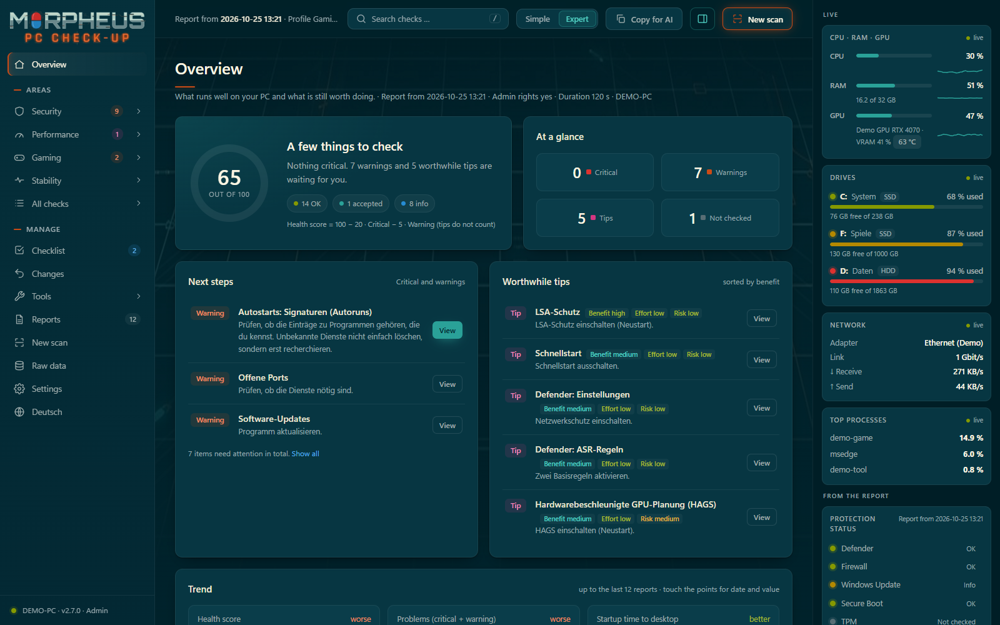<br><sub>Overview in “Expert” mode with live status bar</sub></td>
    <td align="center">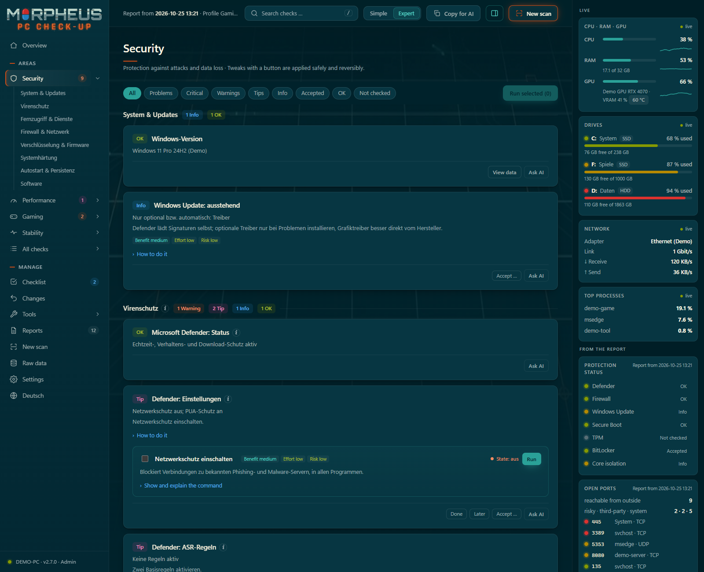<br><sub>Security: finding with tweak and “Ask AI”</sub></td>
  </tr>
  <tr>
    <td align="center">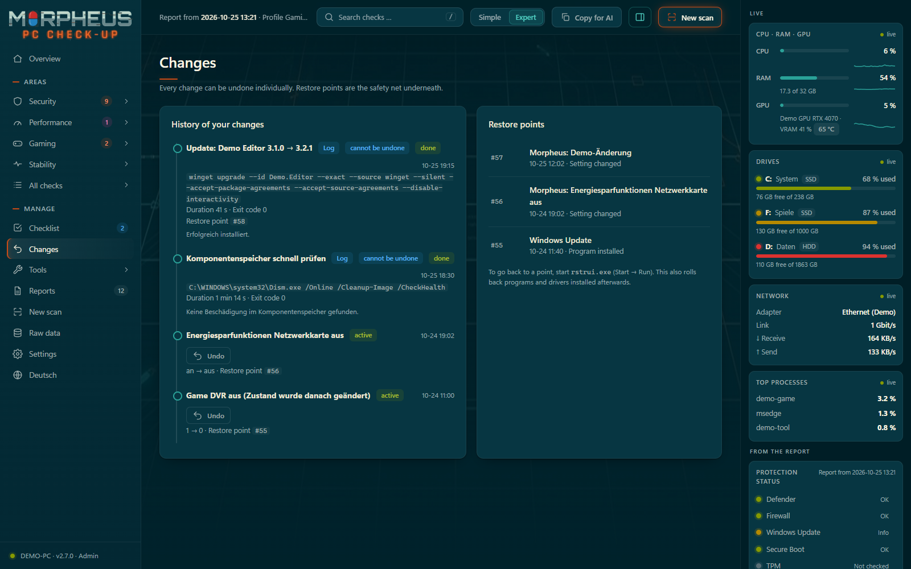<br><sub>Changes with “Undo”</sub></td>
    <td align="center">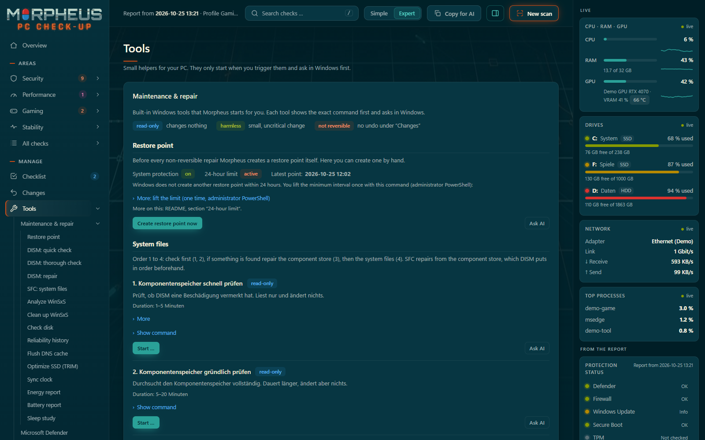<br><sub>Tools</sub></td>
  </tr>
  <tr>
    <td align="center">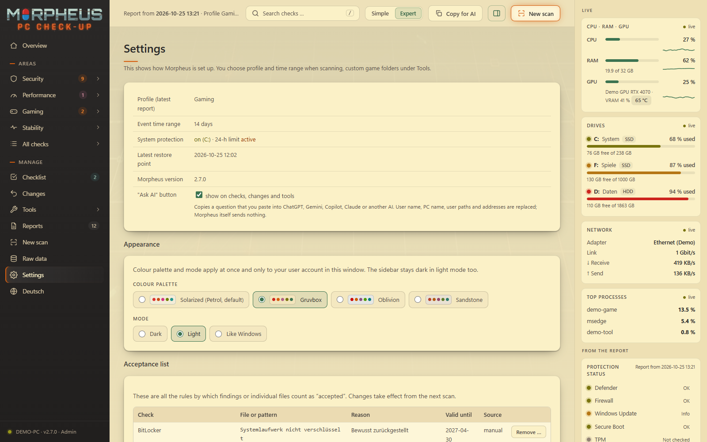<br><sub>Settings › Appearance (Gruvbox, light)</sub></td>
    <td align="center">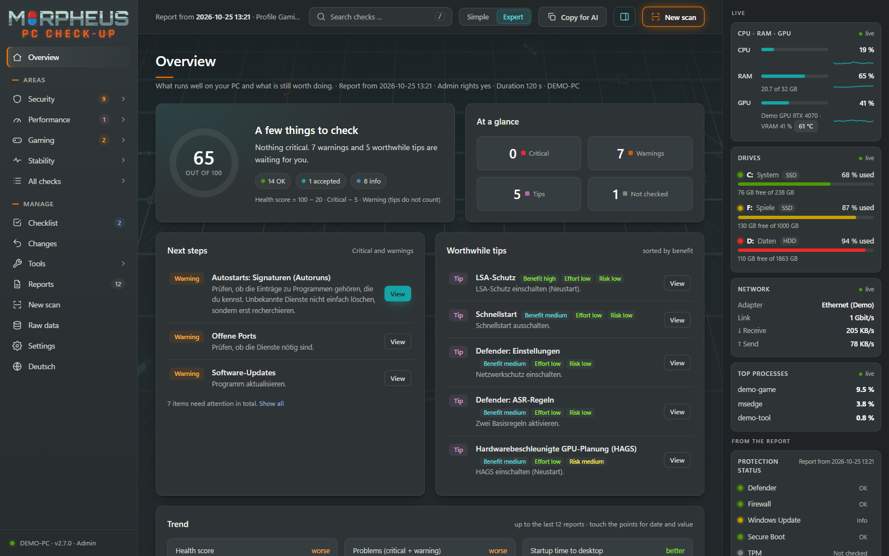<br><sub>Oblivion palette, dark</sub></td>
  </tr>
  <tr>
    <td align="center">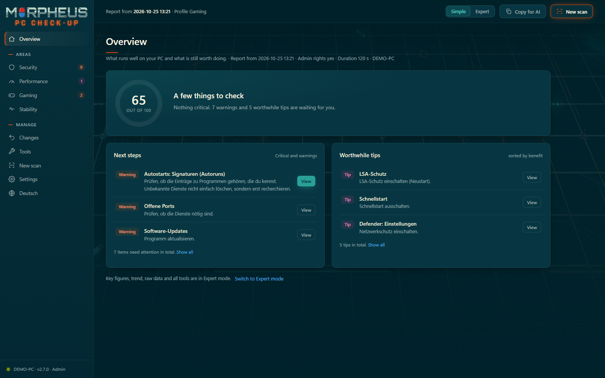<br><sub>Overview in “Simple” mode</sub></td>
    <td align="center">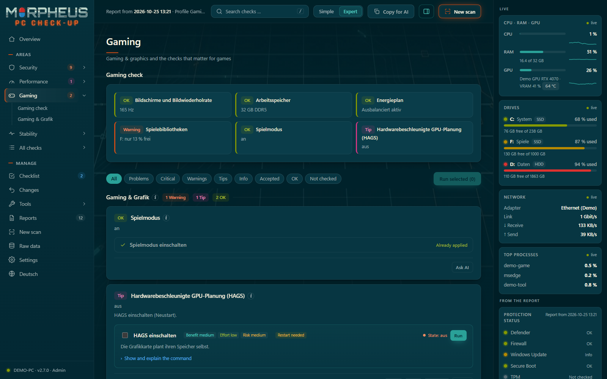<br><sub>Gaming</sub></td>
  </tr>
</table>

### Features

**Check**
- **About 110 checks** on security and performance: updates, antivirus, firewall, drivers, autostart, hardware, power, audio, stability, backup. The scan only reads.
- **Storage usage:** the ten largest folders, files and games per drive. Morpheus deletes nothing.
- **Sysinternals (optional):** Autoruns and Sigcheck check autostarts and system files for signatures. They are only downloaded when you click.
- **Gaming check:** everything relevant for games at a glance, e.g. refresh rate, HAGS, game libraries, installed games and (from 2.7) the global NVIDIA driver settings.
- **Audio (from 2.7):** driver errors, audio services, default devices, USB power saving and automatic volume ducking, read-only.

**Understand**
- **Health score 0–100:** how well the PC is doing. 100 minus 20 per critical finding and minus 5 per warning. Tips do not lower the score (from 2.7).
- **Explanations and click paths:** every check has an i icon with an explanation. “How to” shows the click path or a command to copy. References to Windows settings (`ms-settings:…`) can be clicked directly.
- **“Ask AI” (from 2.7):** copies a ready-made question about a finding, tweak or tool, including this PC's result, for an AI of your choice. Personal details are replaced. See [“Ask AI”](#ask-ai).
- **“Copy for AI”:** copies all findings **anonymised** (without PC name, user, IP and MAC addresses, SIDs and e-mail addresses) to the clipboard. Still read the text briefly before pasting.

**Improve**
- **17 one-click tweaks:** each with a confirmation dialog, the command to review and an explanation.
- **Checklist:** mark items as “done” or “later”. The next run shows what is really fixed.
- **Maintenance & repair:** DISM, SFC, component store, chkdsk, flush DNS, ReTrim, time sync, power reports and reliability history, with fixed commands, Windows confirmation and an easy-to-read summary.
- **Update programs:** winget updates with selection, progress and result. winget runs without admin rights; installers that need them ask via Windows themselves.

**Protect**
- **Restore point before every change**, undo for each change individually, even while the 24-hour limit is active (from 2.7, see below).
- **Change journal** with the history of all tweaks, in plain language (“off → on”).
- **Accept list** for findings that are intentional; accept and revoke them right in the GUI.
- **Defender tools:** update signatures, quick scan, offline scan.
- **Repair the data folder:** if user accounts gained extra rights on the data folder (e.g. via “Continue” in Explorer), Morpheus offers to repair it.

**Monitor**
- **Live status bar:** CPU, RAM, GPU with temperature, drives, network and top processes, plus the protection lights from the report. Can be shown or hidden.
- **Trend:** problems, boot time and free space over the last runs.
- **Report comparison:** any two reports side by side. Changed results as well as new (➕) and removed (➖) services, drivers, autostarts, firewall rules, programs, browser extensions, accounts and open ports stand out.

**Customise**
- **German and English:** interface, findings, explanations, reports and console.
- **“Simple” or “Expert” view** and **four colour palettes** in light and dark (from 2.7).

### Using Morpheus

| Area | Content |
|---|---|
| Overview | Health score, next steps, most worthwhile tips; in “Expert” mode also key figures, trend and changes since the last scan |
| Security | Findings of categories 1–10, each with a matching tweak |
| Performance | Hardware, drives and storage, power, load, audio. Clicking a drive shows its ten largest folders, files and games |
| Gaming | Gaming check and gaming & graphics, including NVIDIA driver settings |
| Stability | Crashes, hardware errors, boot time |
| All checks | All checks by area and category (“Expert” only) |
| Checklist | Mark items as “done” or “later” (“Expert” only) |
| Changes | Journal with “↶ Undo” and list of restore points |
| Tools | Defender (signatures, quick scan, offline scan with countdown, the PC restarts); update programs (winget); in “Expert” mode also maintenance & repair, create restore point, reliability history, own game folders and Sysinternals tools |
| Reports | All runs, open the original report, compare two reports (“Expert” only) |
| New scan | Options, start, live log; afterwards the new report opens |
| Raw data | Detail tables behind the checks (“Expert” only) |
| Settings | Profile, time range, “Ask AI” button on/off, appearance (colour palette and light/dark), accept list |

What the “Simple” menu hides stays reachable through links. Search is at the top (“Expert” only). Press `/` to jump there.

#### View: Simple or Expert (from 2.7)

The switch at the top right toggles between two views. The choice applies per user.

- **Simple** (default on first start): health ring with a plain-language summary, three next steps and three tips. Each area only lists findings that need action; all others are in an expandable line “N more checks need no action”. Under “Tools” there are only Defender and program updates.
- **Expert:** all checks, filters and multi-select, raw data, reports, checklist, status bar, search and all tools.
- **The same in both views:** confirmations, restore points, warnings, accept, “Ask AI” and undo.

#### “Ask AI” (from 2.7)

The small “Ask AI” button is on every finding, tweak and tool. A click copies a ready-made question to the clipboard: what is this, what effects does it have, how critical is it (harmless to urgent), what are the benefits and drawbacks of a change, and what can a beginner do on their own. Paste it with `Ctrl+V` into ChatGPT, Gemini, Copilot, Claude or any other AI.

- This PC's result is included. **PC name, user name, user paths, e-mail addresses, SIDs, MAC and IP addresses are replaced by placeholders.**
- **Protection against injected instructions:** values from the PC (e.g. the name of an autostart entry) are placed in a data block with a random marker, and the AI is told to read it as data only. Control and direction characters are removed, the length is limited.
- **Morpheus itself sends nothing.** It only copies text; you decide what you paste.
- The button can be hidden under Settings.

#### Colour palettes (from 2.7)

Under **Settings › Appearance** you choose the colour palette (Solarized as default, Gruvbox, Oblivion, Sandstone) and the mode (Dark, Light, Like Windows). The choice applies immediately and per user. The sidebar stays dark in light mode too.

#### Menu

Every area with an arrow `›` expands its sub-items: Security, Performance, Gaming and Stability their categories, “All checks” the status filters, “Tools” the cards and, under “Maintenance & repair”, each individual tool. A click jumps straight there. With the keyboard: up/down arrow changes the entry, right arrow expands or moves to the first sub-item, left arrow collapses or goes back to the area, Enter opens. In “Simple” mode the menu has no sub-items.

#### Language

Morpheus is available in German and English: interface, findings, explanations, reports and console. On first start the Windows language applies (German on German Windows, English otherwise). Switch it in the menu under “Manage”. The choice is stored in `C:\ProgramData\Morpheus\state\sprache.json` and also applies to the scan via `pc-check.cmd`. A report stays in the language that was set when it was created. Accepted findings apply in both languages.

#### Common tasks

**Apply a tweak:** the card at a finding shows the tweak. “▸ Show and explain the command” shows the PowerShell command with an explanation. Then click “Run”, confirm the dialog and finally click “Yes” in the Windows window “Morpheus – Confirm change”. In “Expert” mode several tweaks can be run together. If the target state is already reached, the card says “Already applied”. If the tweak needs a restart, the card shows “Done – restart pending” until then.

**Finding card:** every finding has one main action. Done, Later, Accept and “View data” are in the footer; “View data” jumps to the matching detail table.

**Undo a tweak:** in **Changes** pick the entry and click “↶ Undo”. The journal shows values in plain language, e.g. “off → on”. If the state has changed in another way since, the GUI asks first.

**Compare reports:** in **Reports** tick two rows and click “Compare”. “Original HTML” opens the unchanged report.

**Storage window:** hover over a drive on the “Drives” card (or click it or press Enter) to see its ten largest folders, files and games. It is based on the last scan or on “Recalculate”; the date is shown in the window. Clicking an entry copies its path. Morpheus deletes nothing. System files such as `pagefile.sys` are labelled “Windows”.

**Defender tools:** under **Tools** you update Defender signatures, start a quick scan or an offline scan. The offline scan needs a double confirmation and a 15-second countdown, then the PC restarts. There is also a button directly on the Defender finding.

**New scan:** in **New scan** choose the options and start. The live log shows progress. Afterwards the new report opens.

**Reading the report:** status per check: **Critical**, **Warning**, **Tip**, **Accepted**, **Info**, **OK**, **Not checked**. Clicking a number next to the traffic light filters by that status. Tips are sorted by benefit relative to effort and risk. Pure information stays “Info”.

**Status bar:** the right-hand status bar (can be hidden) shows live values for CPU, RAM and GPU (including temperature), drives, network and top processes. Below it is the status from the report: protection lights, open ports, stability and safeguards. The server only collects live values while the GUI asks for them.

### One-click tweaks

Cards with a tweak appear right at the matching finding.

| Area | Tweak | Restart needed |
|---|---|---|
| Security | Defender network protection on | No |
| Security | Protection against potentially unwanted apps on | No |
| Security | ASR rules for vulnerable drivers and LSASS credential theft: block or audit only | No |
| Security | Remote Assistance off | No |
| Security | Remote Desktop off | No |
| Security | LLMNR off | No |
| Security | Turn on System Protection (restore points) | No |
| Security | Increase restore point storage to 10 % | No |
| Security | LSA protection on | Yes |
| Security | Vulnerable driver blocklist on | Yes |
| Performance | Fast startup off | No |
| Performance | PCIe power management (ASPM) off | No |
| Gaming | Game Mode on | No |
| Gaming | Hardware-accelerated GPU scheduling on | Yes |
| Gaming | Background recording (Game DVR) off | No |
| Gaming | Mouse acceleration off (takes effect after signing out and in) | No |
| Gaming | Network adapter power saving off (connection drops briefly) | No |

Morpheus never restarts the PC automatically. For tweaks that need a restart the GUI shows a note.

**Restore point storage and “Point-in-time restore”:** if “Point-in-time restore” is active on Windows 11, Windows resets the storage limit to its own setting on every start. Morpheus then changes nothing and shows a note with a clickable link to Settings (`ms-settings:recovery`): Settings › System › Recovery › Point-in-time restore, 50 GB at most. Run the scan again after a restart.

**Not one-click:** BIOS, Secure Boot, BitLocker, drivers, deleting things, accounts and firewall rules are covered by instructions only. They cannot be reverted cleanly.

### Safeguards for changes

Every tweak runs in fixed steps:

1. Read the current state.
2. Check the prerequisites.
3. Create and verify a restore point. Without it, nothing is changed. The points are named “Morpheus: …”.
4. Write an entry to the change journal.
5. Apply the change.
6. Verify. If it did not work, it is reverted immediately.

**Undo:** each change can be reverted individually and gets its own restore point for it. Undo restores exactly the old state, even if a value did not exist before.

**Revert everything:** `rstrui.exe` starts System Restore. It also rolls back programs and drivers installed afterwards.

#### 24-hour limit

By default Windows creates at most one restore point per 24 hours. This limit is active on almost every PC.

- **Run:** the dialog explains the limit beforehand. The note is only highlighted if Morpheus itself created a point in the last 24 hours. If no new point is created, Morpheus refuses the change.
- **Undo (from 2.7):** if no new point is possible, the point created when the change was run protects the undo, as long as it still exists unchanged. It captures exactly the state that undo returns to. If it is gone, undo stops and the dialog explains the way out.
- **Lifting the limit:** Morpheus shows the command collapsed under “More: lift the limit (one time, administrator PowerShell)”. You run it yourself in an administrator PowerShell:

```powershell
New-ItemProperty -Path 'HKLM:\SOFTWARE\Microsoft\Windows NT\CurrentVersion\SystemRestore' -Name SystemRestorePointCreationFrequency -PropertyType DWord -Value 0 -Force
```

To revert:

```powershell
Remove-ItemProperty -Path 'HKLM:\SOFTWARE\Microsoft\Windows NT\CurrentVersion\SystemRestore' -Name SystemRestorePointCreationFrequency
```

The GUI deliberately does not change this setting itself. Under Tools › Maintenance & repair, “Create restore point now” creates a point manually.

**Exception:** “Turn on System Protection” runs without a restore point because none can be created before. Caution: its undo turns protection off and deletes all restore points.

### GUI security

The GUI runs with admin rights. That is why strict rules apply:

- The server only listens on `127.0.0.1`.
- Edge only receives a one-time code. The GUI exchanges it for the random session token. The token never appears in a command line, address or log.
- Host and origin of every request are checked. Changes are only possible via POST with JSON.
- The GUI can only trigger fixed actions from the catalogue, never arbitrary commands.
- Original reports run in an isolated frame with a one-time read ticket.
- The code lives in `C:\Program Files\Morpheus`, the data in `C:\ProgramData\Morpheus`. Only administrators can change either.
- Everything Morpheus loads also comes only from folders that only administrators can change: PowerShell modules only from `C:\Windows\System32` and `C:\Program Files`, Windows programs with full paths, winget only from the signed App Installer, temporary files under `C:\ProgramData\Morpheus\temp`.
- Maintenance tools and program updates only run from a fixed catalogue with fixed program paths. The GUI only sends a tool id, a drive from the list determined by the server, or package ids from the list the server searched last.
- **Every change and every undo is additionally confirmed in a Windows dialog** (“Morpheus – Confirm change”). It belongs to the process with admin rights; Windows prevents programs without admin rights from clicking or typing in it. So even malware remote-controlling the Morpheus window cannot change anything. “No” is the default.
- Links in findings only open Windows settings (`ms-settings:…`) matching a fixed pattern, no other addresses.
- Only administrators can read and change the data in `C:\ProgramData\Morpheus`. Reports contain programs, accounts and network details; other user accounts on the PC cannot see them either. You view them in Morpheus under “Reports”.
- **Do not open `C:\ProgramData\Morpheus` in Explorer via “Continue”.** Explorer then permanently grants your account full access. Any program running under your account could then change the journal, accept list and temporary files. Morpheus detects this on the next start and offers to repair the permissions (banner “The data folder's permissions were changed”, button “Repair permissions …”, after Windows confirmation). Afterwards restart Morpheus and check under “Changes” and “Settings › Accept list” that all entries are yours. To look at the folder, open PowerShell as administrator, e.g. `Get-ChildItem C:\ProgramData\Morpheus\reports`. To repair manually in an admin PowerShell:
  ```powershell
  icacls C:\ProgramData\Morpheus /remove:g "*$([Security.Principal.WindowsIdentity]::GetCurrent().User.Value)" /T /C
  ```
- The server ends with the window. If a tool is still running, it waits until it has finished.

Architecture and security model in detail: `docs/gui-architektur.md` (German).

#### Repairing the data folder

- **When:** only if user accounts have extra rights on `C:\ProgramData\Morpheus`. If the folder has a foreign owner or contains links, Morpheus moves it aside.
- **What happens:** Morpheus removes the extra rights (after Windows confirmation). `temp` and `tools` are recreated, `tools` is downloaded again if needed (Sysinternals).
- Journal, accept list and checklist are kept and rewritten. Reports stay unchanged.
- **Create new instead:** the old folder is moved aside as `Morpheus.unsicher-<date>`, then an empty folder is created.
- **Undo:** for older journal entries only with an extra confirmation. Check beforehand that you made the change yourself.
- Restart Morpheus afterwards.

### Where is my data?

| What | Installed copy | Without installation (read-only) |
|---|---|---|
| Program | `C:\Program Files\Morpheus` | Folder you start from |
| Reports | `C:\ProgramData\Morpheus\reports\` | Folder `reports\` next to the script |
| Change journal | `C:\ProgramData\Morpheus\changes\journal.json` | as left, changes blocked |
| Checklist | `C:\ProgramData\Morpheus\state\checklist.json` | as left |
| Accept list | `C:\ProgramData\Morpheus\accepted.psd1` | as left |
| Language | `C:\ProgramData\Morpheus\state\sprache.json` | as left |
| Sysinternals tools | `C:\ProgramData\Morpheus\tools` | not available |
| Own game folders | `C:\ProgramData\Morpheus\state\spielordner.json` | as left |
| Log | `C:\ProgramData\Morpheus\state\gui.log` | as left |
| View, colour palette, “Ask AI” on/off | browser storage of the Morpheus window, per user | as left |

Only administrators can read and change the folder; you see reports in Morpheus under “Reports”. The installation takes over existing reports and `accepted.psd1` once.

### Scan only (without GUI)

If a current installation exists in `C:\Program Files\Morpheus`, `pc-check.cmd` runs the scan from that installed copy. This way code from a folder that programs without admin rights could change never gets admin rights.

1. **Double-click `pc-check.cmd`** and confirm the admin prompt (UAC) with “Yes”. If Windows shows “Windows protected your PC”: **More info → Run anyway**.
2. The run takes about 4–6 minutes.
3. At the end the script asks whether to install available program updates (`1,3`, `a` for all, **Enter for none**).
4. The **report opens automatically in the browser**. It is saved in the `reports\` subfolder as `pc-check_<date>.html`, plus `.md` (text) and `.json` (for comparison with the next run).

Alternatively in an **administrator PowerShell** in the folder:

```powershell
powershell.exe -NoProfile -ExecutionPolicy Bypass -File .\pc-check.ps1
```

`-ExecutionPolicy Bypass` only applies to this call and changes no setting. Without admin rights the script also runs but skips some checks (BitLocker, TPM, security log …). For compatibility the files are still named `pc-check.*`.

| Parameter | Meaning |
|---|---|
| `-EventDays 30` | Evaluate event logs of the last 30 instead of 14 days (1–90) |
| `-OutputDir <path>` | Save the report elsewhere |
| `-SkipUpdateSearch` | No online search for pending Windows updates |
| `-SkipWinget` | No check for software updates via winget |
| `-SkipSpeicher` | No analysis of the largest storage consumers (saves 1–3 minutes) |
| `-SkipSysinternals` | Do not use Autoruns and Sigcheck |
| `-SpielOrdnerFile <path>` | File with your own game folders (default: `state\spielordner.json` in the data folder) |
| `-NoUpdatePrompt` | No question about program updates at the end (read-only run) |
| `-CompareWith <path>` | Compare with this report instead of the latest one in `reports\` |
| `-AcceptedFile <path>` | Use a different accept list |
| `-NoOpen` | Do not open the HTML report in the browser at the end |
| `-Profil Gaming` | Weight recommendations for `Gaming`, `Office` or `Laptop` (default: automatic, laptop with battery, gaming with a dedicated graphics card) |

#### The report (HTML)

- **Traffic light** with an overall assessment and **the next steps**, below them the **most worthwhile tips**.
- **Tips with benefit, effort and risk**, sorted by benefit relative to effort and risk.
- **“How to”** on warnings and tips: the click path through Settings, often with a command to copy; links to Windows settings are clickable.
- **My checklist**, **gaming check**, **trend** as small charts, **filter and search**, **i icon** with an explanation on every check.
- **Known harmless events** are classified by Morpheus itself (e.g. service errors of removed programs, routine account changes by Windows).
- **Changes since the last run**, **all checks** with expandable **raw data**, **“How to read the report”** and **“Copy for AI assistant”** (anonymised).

The file is self-contained and works without internet.

#### Update dialog at the end

Applies to the console scan (`pc-check.cmd`); in the GUI use Tools › Update programs. After the report is finished the script lists available **program** updates with numbers and asks which ones to install (`1,3`, `a` for all, Enter for none).

- winget downloads the updates from the vendors' sources and **accepts the packages' license terms**.
- Not offered: games and launchers, programs with their own updater (Edge, Teams, Outlook, VS Code, Autodesk Fusion) and entries winget knows but Windows no longer lists as installed.
- winget runs without admin rights; installers that need them ask via Windows themselves.
- If an installer aborts because the program is still running, the dialog offers a second try after you close it.
- The result is appended to the report as the section “Updates after the run”.

### Intentional findings (`accepted.psd1`)

Some things on your PC are intentional, e.g. a remote support tool you use. So that it does not show up as a warning on every run:

- **In the GUI:**
  - At the finding choose “Accept …” and enter a reason, optionally an expiry date. The rule applies to exactly the current finding text.
  - Unsigned system files (Sigcheck) are accepted individually under “View data”. The rule is bound to the file's SHA256: if the file changes, the warning returns.
  - It is saved only after the Windows confirmation dialog.
  - Under Settings › Accept list you revoke rules.
  - It takes effect from the next scan.
- **Manually:**
  1. Copy `accepted.example.psd1` to `accepted.psd1` (installed: `C:\ProgramData\Morpheus`, edit as administrator).
  2. Add entries following the example; take the finding text from your own report.
  - When the GUI writes the file, your rules are kept but comments are not. The previous version is kept next to it as `accepted.psd1.bak`.

Matching findings then show as “Accepted” and do not count towards the health score. A narrow pattern (`Match`) makes sure the warning returns as soon as something changes. With `Until` an item comes back after a date. `accepted.psd1` is excluded from the repository via `.gitignore`.

### Maintenance & repair

Under **Tools › Maintenance & repair** (“Expert” mode) Morpheus starts Windows' own tools with fixed commands. Each tool shows the exact command, runs in the background with live output and asks in the Windows dialog first. There are three classes:

| Class | Meaning | Tools |
|---|---|---|
| read only | changes nothing | DISM `/CheckHealth`, `/ScanHealth`, `/AnalyzeComponentStore`; `chkdsk C: /scan` (drive selectable); `powercfg /energy`, `/batteryreport`, `/sleepstudy` |
| harmless | small maintenance without risk | Create restore point; `ipconfig /flushdns`; ReTrim for SSDs (`defrag C: /L`, the same as `Optimize-Volume -ReTrim`); `w32tm /resync` |
| irreversible | repair or cleanup | DISM `/RestoreHealth` (needs internet), `sfc /scannow`, DISM `/StartComponentCleanup` |

- **Irreversible means:** there is no “Undo” for it under “Changes”. Morpheus first creates and verifies a restore point automatically. If that fails (e.g. 24-hour limit), nothing starts. Only after an explicit extra confirmation does it continue without a point; the Windows dialog then says so clearly.
- **Order for system files:** 1. CheckHealth, 2. ScanHealth, 3. RestoreHealth, 4. `sfc /scannow`. SFC repairs from the component store that DISM fixes first.
- **Component store:** Morpheus does not use `/ResetBase` (it makes installed updates permanent). Never delete the `WinSxS` folder by hand.
- **Cancel** works for read-only tools, chkdsk, ReTrim and the power report. DISM repair, cleanup and SFC should not be interrupted; there is no cancel button for them.
- **Result:** Morpheus summarises the output in plain language (German and English Windows output) and writes a log with command, duration, exit code and summary to the change journal.
- **Power reports** are saved to `C:\ProgramData\Morpheus\reports` and open in Morpheus in the isolated frame.
- **Reliability history** (`perfmon /rel`) opens without admin rights. If that fails: `Win + R`, `perfmon /rel`.
- Deliberately not included (later or instructions only): `chkdsk /f`, memory test, resetting Windows Update, removing old drivers, network reset.

### Updating programs

Under **Tools › Update programs** Morpheus searches for updates with winget, you choose the programs, and Morpheus installs them with progress and a result per program.

- A restore point is created first. **Program updates cannot be reverted via “Changes”**; the journal holds a log per program.
- Only programs from the list Morpheus searched last are offered (same rules as the console update dialog).
- “Cancel” stops after the program currently being installed.
- **winget runs without admin rights,** both for the search and for the updates. Morpheus starts winget via a short-lived scheduled task under your account with the normal user token (like a program from the Start menu). The task is deleted after each program. If an installer needs admin rights, Windows asks itself (User Account Control). **Check the publisher there:** if it says “Unknown” or an unexpected name, choose “No”. If you decline, Morpheus reports the program as “not updated”.
- Morpheus only starts winget from the signed App Installer package in `C:\Program Files\WindowsApps`, never via the search path. This also applies to the scan.

### Sysinternals tools

Morpheus can use two free tools from Microsoft Sysinternals: **Autoruns** (all autostarts: services, drivers, scheduled tasks, logon, Explorer) and **Sigcheck** (signatures of the files in `System32` and `System32\drivers`). They are not included and are only downloaded when you click:

1. Morpheus › **Tools** › card “Sysinternals (Microsoft)” › **Download …** (“Expert” mode)
2. Read the license terms (link) and tick the box. The consent is saved.
3. Confirm in the Windows dialog.

- **Source:** only `https://download.sysinternals.com/files/Autoruns.zip` and `Sigcheck.zip` (about 4 MB together). This is the only connection. There is no VirusTotal lookup, so no data leaves the PC.
- **Location:** `C:\ProgramData\Morpheus\tools` (administrators only). Only `autorunsc64.exe`, `sigcheck64.exe` and the license text are extracted.
- **Before every start** Morpheus checks: folder and file can only be changed by administrators, file unchanged since download (SHA256), valid signature by Microsoft Corporation with a Microsoft root certificate, version info “Sysinternals”. During the run the file is locked against replacement. If a check fails, the tool does not start and the scan reports it.
- **In the scan:** checks “Autostarts: signatures (Autoruns)”, “Autostarts: writable paths (Autoruns)” and “System files: signatures (Sigcheck)”, each with a table under “View data”. Without the tools set up or without admin rights they are skipped. Turn off with `-SkipSysinternals` or the checkbox under “New scan”.
- **Verification help:** for unsigned system files there is “Scan with Defender”, a VirusTotal link and “Copy hash” per file.
- **Remove:** Tools › “Remove …” deletes the files and withdraws the consent.

### Starting from a Store app

Store apps (MSIX) virtualise parts of the registry (`HKCU`) for all processes they start, even with admin rights. If Morpheus is started from such an app, results under `HKCU` may differ. The “Execution environment” check warns about this. Best start it by double-clicking `pc-check-gui.cmd` or `pc-check.cmd`, or from a normal PowerShell window.

### Privacy

- Everything runs **locally**. No data is sent to the author or third parties.
- Network access only happens for the Windows Update search, winget and the UPnP query to your own router, and on your click for Sysinternals, DISM `/RestoreHealth` (Windows Update) and time sync (`w32tm /resync`).
- “Ask AI” and “Copy for AI” only put text on the clipboard. Personal details are replaced. Still read the text briefly before pasting.
- The report contains many details of your PC (programs, accounts, network, drivers). It stays local and is excluded via `.gitignore`. **Do not share or upload it carelessly.**

### What is checked

**Security:** Windows version and updates, Defender (status, settings, ASR rules, exclusions, detections), firewall and open ports, UPnP port forwards on the router, SMB/shares, accounts and password policy, UAC, core isolation/memory integrity, LSA protection, driver blocklist, exploit protection, Spectre tweaks, Secure Boot (including 2023 certificates), TPM, BitLocker, BIOS, backup (File History, OneDrive folder backup, system image), restore points, remote access (RDP, remote support tools), third-party services and drivers (including known vulnerable drivers), service paths, autostart (with Sysinternals Autoruns also all autostart locations, signatures and writable paths), unsigned system files (Sysinternals Sigcheck), scheduled tasks, WMI persistence, browser extensions, outdated software, security-relevant events.

**Performance:** CPU, RAM (XMP, dual channel), GPU driver, monitor refresh rate, drives (type, health, space, TRIM), largest storage consumers per drive, page file, power plan, gaming settings (Game Mode, HAGS, Game DVR, overlays), NVIDIA driver settings (shader cache, power management, V-Sync, max frame rate, G-SYNC), Resizable BAR and PCIe link (NVIDIA), game libraries, installed games (Steam, Epic, GOG, EA, Ubisoft, Xbox), network adapter power saving, background load, number of autostarts, network, audio (driver errors, services, default devices, USB power saving, ducking), stability (hardware errors, blue screens, graphics driver crashes, throttling, application crashes, boot time).

### Side effects (not on the system)

- `secedit` exports the security policy to a temp file that is deleted immediately.
- `Add-Type` compiles small helper classes to read refresh rates and NVIDIA driver settings (read-only, `nvapi64.dll` only from System32 after a signature check).
- Windows Update search, winget and the UPnP query go to the internet or the router. The scan itself downloads nothing from Sysinternals; that only happens on a click in the GUI.
- Autoruns and Sigcheck (if set up) run 1–3 minutes each. They remember the accepted license in the signed-in user's registry (`HKCU\Software\Sysinternals`).
- The storage analysis counts all files on fixed drives (names and sizes only, no contents), follows no links or junctions and takes 1–3 minutes depending on the drives.
- Only the update dialog or “Update programs” installs anything, and only what you explicitly select. Repairs under “Maintenance & repair” only run on your click after Windows confirmation.

### Development

- **Mock mode** without admin rights and without a real scan: start a server in the `gui` folder, e.g. `python -m http.server 8791 --bind 127.0.0.1`, and open `http://127.0.0.1:8791/dev/mock.html`. Routes are hash addresses, e.g. `#/uebersicht`, `#/sicherheit`, `#/aenderungen`, `#/gaming`, `#/werkzeuge`, `#/einstellungen`. Parameters before the `#`: `?nav=sicherheit,werkzeuge` expands menu items, `?modus=experte` or `?modus=einfach` sets the view, `?palette=gruvbox&theme=light` the appearance, `?sprache=en` the language, `?latenz=1500` simulates a slow server. The screenshots in `docs/screenshots/` are made this way with demo data.
- **Tests** use Pester 3.4, which ships with Windows. Run in the project folder: `Invoke-Pester .\tests`. The tests change nothing on the system.
- **Action catalogue:** new actions in `pc-check.aktionen.ps1` need read, run, undo and an entry in `tests/Aktionen.Tests.ps1`.
- **Colour palettes** are generated with `gui/dev/make-palettes.ps1` into `gui/palettes.css`.

### Versions

- **2.7.0 (2026-11-08):**
  - **“Simple | Expert” view** with a switch in the header; “Simple” is the default and shows the state, next steps and only open findings.
  - **“Ask AI” button** on findings, tweaks and tools: copies a question including this PC's result, personal details replaced, protected against injected instructions; can be hidden in Settings.
  - **Colour palettes** Solarized, Gruvbox, Oblivion and Sandstone, each dark, light or like Windows (Settings › Appearance).
  - **New check “NVIDIA driver settings”** in the gaming section (shader cache, power management, V-Sync, max frame rate, G-SYNC), read-only.
  - **New “Audio” category:** driver errors, audio services, default devices (note for HDMI/DisplayPort), USB power saving, ducking, read-only.
  - **Undo despite the 24-hour limit:** the restore point of the original run protects the undo if it still exists; otherwise the dialog explains the way out.
  - **“Done – restart pending”** on cards and next steps.
  - **Health score:** tips no longer lower the score.
  - **Point-in-time restore:** note with a clickable link to Settings; 49 GB or more counts as sufficient.
  - **Links to Windows settings** (`ms-settings:…`) in recommendations and messages are clickable.
  - **Calmer interface:** one main action per finding, one “Ask AI” per finding, tips in the overview lead to the finding (“View”), no more 24-hour banner, the command to lift the limit only collapsed, applied tweaks as a single line.
  - **Plain language:** journal and undo dialog show “off → on” instead of raw values; the ASR card explains “Block” and “Audit only”; restore points are named “Morpheus: …”.
  - **Accessibility:** focus stays in the right place in dialogs and menus, steps are announced via a status line, better contrast and heading order, no pulsing live dot.
  - **License:** from this version on PolyForm Noncommercial 1.0.0 instead of MIT.
- **2.6.0 (2026-11-02):** German and English fully switchable: interface, findings, explanations, reports and console. Start language follows Windows, switch in the menu. Fixed: an existing file could not be saved a second time (own game folders, storage consumers), exceptions on GUI buttons, overflow in narrow windows.
- **2.5.0 (2026-11-01):** Expandable left menu with categories, filters and individual tools, keyboard operable. **Security:** winget only runs without admin rights; installers that need them ask via Windows. This fixes the residual risk of 2.4.0 (swapped installer in winget's download folder). **Fixed:** restore point storage fell back to 2 % after every restart on Windows 11 with “Point-in-time restore”; Morpheus detects this and names the permanent fix.
- **2.4.0 (2026-10-27):** Tools › Maintenance & repair with a fixed command catalogue, Windows confirmation, live output, verified restore point and log (DISM, SFC, chkdsk, DNS, ReTrim, time, power reports, reliability history); update programs (winget) in the GUI; winget only from the signed App Installer package; repair data folder permissions. **Fixed:** the GUI connection dropped when the window was in the background for 1–2 minutes.
- **2.3.3 (2026-10-26):** Security hotfix against privilege escalation: winget, PowerShell modules, Windows programs and temporary files only from locations that only administrators can change.
- **2.3.2 (2026-10-26):** The “Recovery” check distinguishes “System Protection off” and “storage too small”; new tweak “Increase restore point storage”.
- **2.3.1 (2026-10-26):** Accept and revoke findings and unsigned system files in the GUI; verification help for unsigned system files; wide layout for WQHD and larger; better tables.
- **2.3.0 (2026-10-26):** Sysinternals tools Autoruns and Sigcheck with license consent, signature and hash checks; three new checks; new design.
- **2.2.0 (2026-10-26):** Defender tools, “Backup” check, largest storage consumers per drive, game list for Steam, Epic, GOG, EA, Ubisoft and Xbox.
- **2.1.1 (2026-10-25):** Installation comparison ignores line endings.
- **2.1.0 (2026-10-25):** Name “Morpheus – PC Check-up”, new design with status bar, installation to Program Files.
- **2.0 (October 2026):** GUI with one-click tweaks, restore point and journal.

### Uninstall

Morpheus has no installer. To remove it:

1. Delete the Start menu entry “Morpheus – PC Check-up”.
2. As administrator delete the folders `C:\Program Files\Morpheus` and `C:\ProgramData\Morpheus`. The second folder contains your reports and journal. Back them up first if you want to keep them.
3. Delete the folder with the downloaded ZIP or Git clone.

Changes Morpheus made to the system remain after deleting. If needed, revert them first under **Changes** or pick an earlier point with `rstrui.exe`.

### Maintenance of the check data (as of November 2026)

Some checks contain fixed data that ages over time and should be updated occasionally:

- End of support of Windows 11 versions (“Windows version” check, up to 25H2)
- Minimum versions and end of support of software (WinRAR, 7-Zip, Node.js, Python, Office …)
- List of known vulnerable drivers
- List of game launchers and self-updating programs (`gui/lib/Winget.ps1`)
- Recognised messages of DISM, SFC, chkdsk and powercfg (`gui/lib/WartungAuswertung.ps1`)
- Explanations, tips and click paths (`lang/de/hilfe.psd1`, `lang/en/hilfe.psd1`)
- Known harmless events (`$script:KnownHarmless` in the script)
- GUI action catalogue (`pc-check.aktionen.ps1`)

Hints and improvements are welcome as an issue.

### Use at your own risk

Morpheus is a private tool without warranty. The recommendations are hints, not instructions. Before changing drivers, BIOS, BitLocker or security features, ask or read up if in doubt. The scan itself changes nothing. The GUI only changes settings on an explicit click and after confirmation.

---

## Lizenz / License

[PolyForm Noncommercial License 1.0.0](LICENSE) © 2026 oFAILIXo

**Deutsch:** Du darfst Morpheus privat und für andere nicht-kommerzielle Zwecke frei nutzen, ansehen und anpassen. Die kommerzielle Verwertung (verkaufen, in bezahlte Produkte oder Dienste einbauen, gewerblich einsetzen) ist nur dem Urheber erlaubt. Die Releases bis einschließlich 2.6.0 wurden unter der MIT-Lizenz veröffentlicht und bleiben dort MIT; ab 2.7.0 gilt die PolyForm Noncommercial License.

**English:** You may use, study and modify Morpheus for private and other non-commercial purposes. Commercial exploitation (selling it, building it into paid products or services, business use) is reserved to the author. Releases up to and including 2.6.0 were published under the MIT License and stay MIT; from 2.7.0 on the PolyForm Noncommercial License applies.
