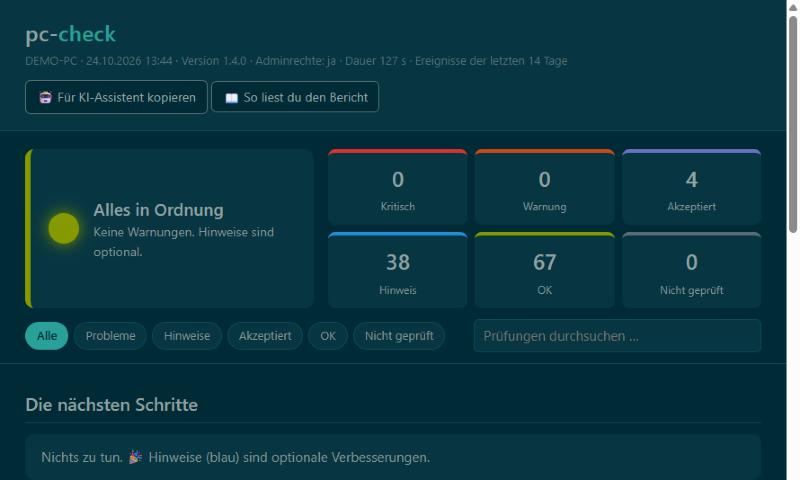
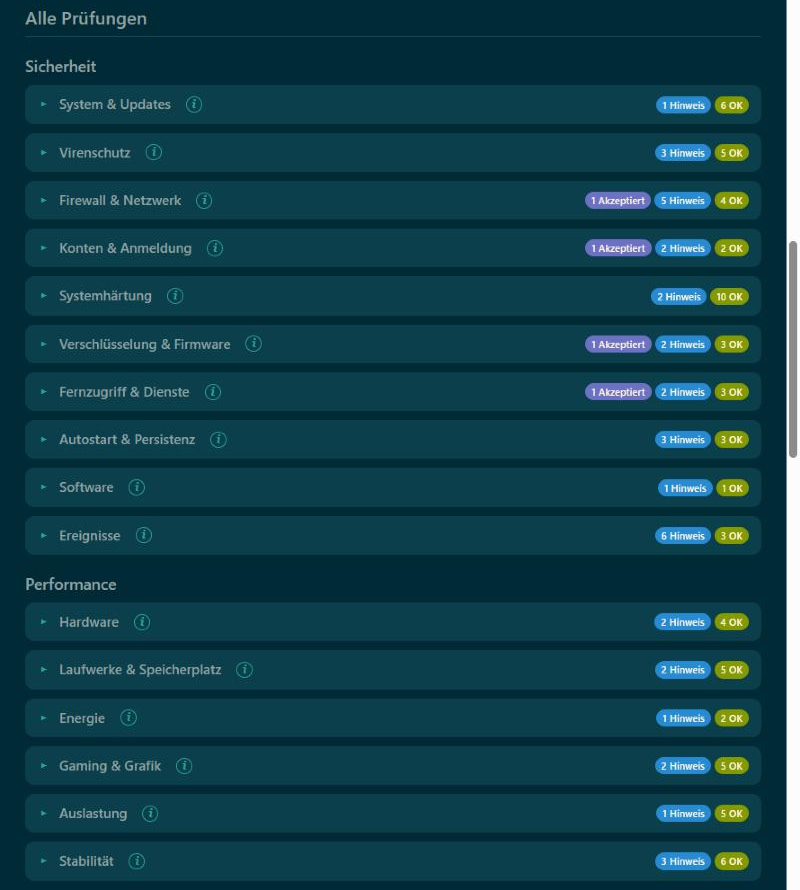
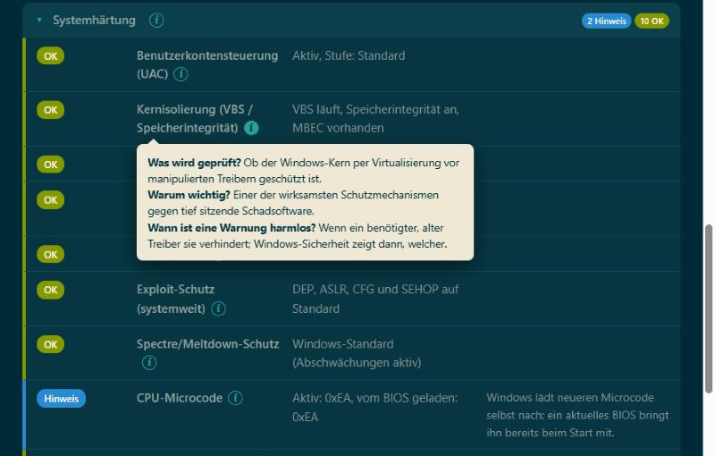
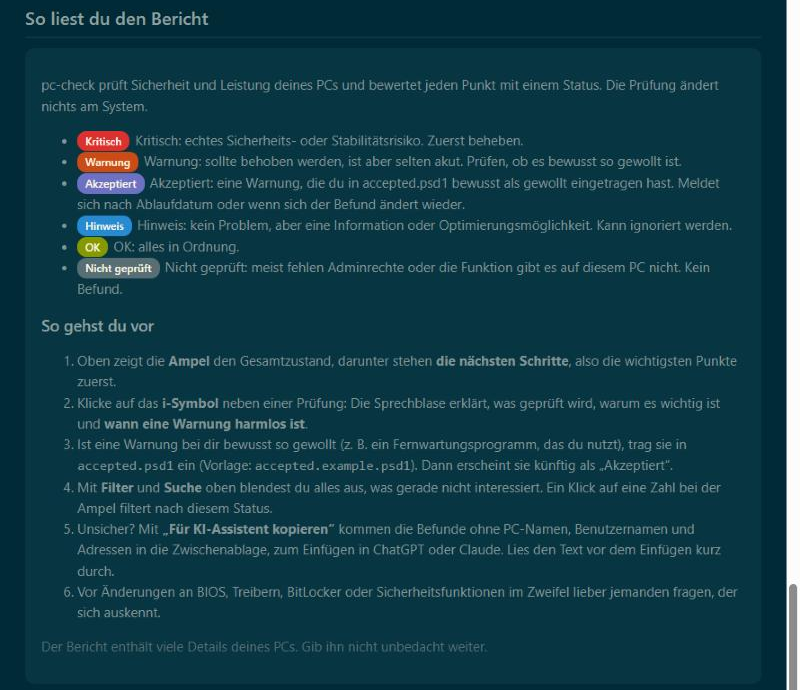

# pc-check

**Sicherheits- und Performance-Check für Windows-11-PCs – ein PowerShell-Script, ein verständlicher HTML-Bericht.**

pc-check prüft über 100 Punkte rund um Sicherheit, Leistung und Stabilität und erklärt jedes Ergebnis in Alltagssprache: *was* geprüft wird, *warum* es wichtig ist und *wann eine Warnung harmlos ist*. **Die Prüfung ändert nichts am System**, sie liest nur aus.

> 🇬🇧 **English summary:** see [below](#english).



## Die interessantesten Features

- **Ampel und „Nächste Schritte“** – auf einen Blick, ob der PC in Ordnung ist und was zuerst zu tun ist.
- **Über 100 Prüfungen in 16 Kategorien** – von Defender, Firewall, Kernisolierung, Secure Boot (inkl. der neuen 2023er-Zertifikate), TPM und BitLocker über anfällige Treiber, Autostart, geplante Aufgaben und WMI-Persistenz bis zu RAM (XMP, Dual-Channel), Monitor-Bildwiederholrate, Energieplan, Gaming-Einstellungen und Bluescreens.
- **Erklärung an jeder Prüfung** – das ⓘ-Symbol öffnet eine Sprechblase mit *Was / Warum / Wann harmlos*.
- **Filter und Suche** – z. B. nur Probleme anzeigen oder gezielt nach „Treiber“ suchen.
- **Vergleich mit dem letzten Lauf** – geänderte Ergebnisse sowie neue ➕ und verschwundene ➖ Dienste, Treiber, Autostarts, Firewall-Regeln, Programme, Browser-Erweiterungen, Konten und offene Ports. So fällt auf, wenn sich etwas Unbemerktes eingeschlichen hat.
- **Akzeptanzliste** – bewusst gewollte Befunde (z. B. ein genutztes Fernwartungstool) als „Akzeptiert“ markieren, optional mit Ablaufdatum.
- **„Für KI-Assistent kopieren“** – kopiert die Befunde **anonymisiert** (ohne PC-Name, Benutzer, IP-/MAC-Adressen, SIDs, E-Mail) in die Zwischenablage, um sie z. B. Claude oder ChatGPT zur Einschätzung zu geben.
- **Update-Dialog am Ende** – listet verfügbare Programm-Updates (winget) und installiert nur, was du auswählst. Spiele, Launcher und selbstaktualisierende Programme bleiben außen vor.
- **Offline und eigenständig** – eine einzelne HTML-Datei im Farbschema Solarized Dark, dazu Markdown und JSON.

| Kategorien mit Filter | Erklärung per ⓘ | Anleitung im Bericht |
|---|---|---|
|  |  |  |

*Die Screenshots stammen aus einem Demo-Bericht mit anonymisierten Daten.*

## Installation

Voraussetzungen: Windows 11 (Windows 10 funktioniert weitgehend), Windows PowerShell 5.1 (vorinstalliert), Adminrechte empfohlen. winget (App-Installer) ist optional für die Update-Prüfung.

**Variante A – ZIP (ohne Git):**

1. Auf GitHub **Code → Download ZIP** wählen.
2. **Rechtsklick auf das ZIP → Eigenschaften → unten „Zulassen“ anhaken → OK.** Sonst blockiert Windows die heruntergeladenen Dateien.
3. ZIP entpacken, z. B. nach `Dokumente\pc-check`.

**Variante B – Git:**

```bash
git clone https://github.com/oFAILIXo/pc-check.git
```

## Nutzung

1. **Doppelklick auf `pc-check.cmd`** und die Adminabfrage (UAC) mit „Ja“ bestätigen.
   Zeigt Windows „Der Computer wurde durch Windows geschützt“: **Weitere Informationen → Trotzdem ausführen** (erscheint bei Dateien ohne digitale Signatur).
2. Der Lauf dauert etwa 4–6 Minuten.
3. Am Ende fragt das Script, ob verfügbare Programm-Updates installiert werden sollen (`1,3`, `a` für alle, **Enter für keine**).
4. Der **Bericht öffnet sich automatisch im Browser**. Er liegt im Unterordner `reports\` als `pc-check_<Datum>.html`, zusätzlich als `.md` und `.json`.

Alternativ in einer **Administrator-PowerShell** im Ordner:

```powershell
powershell.exe -NoProfile -ExecutionPolicy Bypass -File .\pc-check.ps1
```

`-ExecutionPolicy Bypass` gilt nur für diesen Aufruf und ändert keine Einstellung. Ohne Adminrechte läuft das Script auch, lässt aber einige Prüfungen aus (BitLocker, TPM, Sicherheitsprotokoll …).

### Parameter

| Parameter | Bedeutung |
|---|---|
| `-EventDays 30` | Ereignisprotokolle der letzten 30 statt 14 Tage auswerten (1–90) |
| `-OutputDir <Pfad>` | Bericht woanders ablegen |
| `-SkipUpdateSearch` | keine Online-Suche nach ausstehenden Windows-Updates |
| `-SkipWinget` | keine Prüfung auf Software-Updates per winget |
| `-NoUpdatePrompt` | keine Nachfrage nach Programm-Updates am Ende (rein lesender Lauf) |
| `-CompareWith <json>` | mit diesem Bericht vergleichen statt mit dem jüngsten in `reports\` |
| `-AcceptedFile <Pfad>` | andere Akzeptanzliste verwenden |
| `-NoOpen` | HTML-Bericht nicht automatisch öffnen |

### Den Bericht lesen

Status je Prüfung: **Kritisch**, **Warnung**, **Akzeptiert**, **Hinweis**, **OK**, **Nicht geprüft**. Oben stehen Ampel und die wichtigsten nächsten Schritte, darunter die Änderungen seit dem letzten Lauf und alle Prüfungen nach Bereich. Ein Klick auf eine Zahl bei der Ampel filtert nach diesem Status. Unter jeder Kategorie lassen sich die **Rohdaten** aufklappen. Die Erklärungstexte stehen in `pc-check.hilfe.psd1`.

### Bewusst gewollte Befunde (`accepted.psd1`)

1. `accepted.example.psd1` nach `accepted.psd1` kopieren.
2. Einträge nach dem Beispiel in der Datei ergänzen; den Befund-Text aus dem eigenen Bericht übernehmen.

Passende Befunde erscheinen dann als „Akzeptiert“. Ein enges Muster (`Match`) sorgt dafür, dass die Warnung zurückkehrt, sobald sich etwas ändert; mit `Until` meldet sich ein Punkt nach einem Datum wieder. `accepted.psd1` ist per `.gitignore` vom Repo ausgeschlossen.

### Start aus einer Store-App

Store-Apps (MSIX) virtualisieren Teile der Registry (`HKCU`) für alle Prozesse, die sie starten – auch mit Adminrechten. Wird pc-check aus so einer App heraus gestartet, können Ergebnisse unter `HKCU` abweichen; die Prüfung „Ausführungsumgebung“ warnt dann. Am besten per Doppelklick auf `pc-check.cmd` oder aus einem normalen PowerShell-Fenster starten.

## Datenschutz

- Alles läuft **lokal**. Es werden keine Daten an den Autor oder Dritte geschickt.
- Netzwerkzugriffe gibt es nur für die Windows-Update-Suche, winget und die UPnP-Abfrage am eigenen Router.
- Der Bericht enthält viele Details deines PCs (Programme, Konten, Netzwerk, Treiber). Er bleibt im Ordner `reports\` und ist per `.gitignore` ausgeschlossen. **Nicht unbedacht weitergeben oder hochladen** – für Fragen an eine KI die anonymisierte Kopierfunktion nutzen und den Text vorher kurz durchlesen.

## Nebenwirkungen (nicht am System)

- `secedit` exportiert die Sicherheitsrichtlinie in eine Temp-Datei, die sofort gelöscht wird.
- `Add-Type` kompiliert eine kleine Hilfsklasse zum Auslesen der Bildwiederholraten.
- Nur der Update-Dialog installiert etwas – und nur, was du ausdrücklich auswählst. winget akzeptiert dabei die Lizenzbedingungen der Pakete.

## Nutzung auf eigene Verantwortung

pc-check ist ein privates Hilfsmittel ohne Gewähr. Die Empfehlungen im Bericht sind Hinweise, keine Anweisungen: Vor Änderungen an Treibern, BIOS, BitLocker oder Sicherheitsfunktionen im Zweifel nachlesen oder fachkundig nachfragen.

## Pflege (Stand: Oktober 2026)

Einige Prüfungen enthalten feste Daten, die mit der Zeit veralten:

- Supportende der Windows-11-Versionen (bis 25H2)
- Mindestversionen bzw. Supportende von Software (WinRAR, 7-Zip, Node.js, Python, Office …)
- Liste bekannt anfälliger Treiber
- Liste der Spiele-Launcher und selbstaktualisierenden Programme (`Get-UpdateCategory`)
- Erklärungstexte (`pc-check.hilfe.psd1`)

Hinweise und Verbesserungen gern als Issue.

---

<a id="english"></a>
## 🇬🇧 English

**pc-check** is a read-only PowerShell script for Windows 11 that runs 100+ security, performance and stability checks (Defender, firewall, core isolation, Secure Boot, TPM, vulnerable drivers, autostart, scheduled tasks, RAM/XMP, refresh rate, power plan, gaming settings, crashes …) and produces a self-contained HTML report with a traffic-light summary, next steps, filter and search, a comparison with the previous run, and an anonymised “copy for AI assistant” button. At the end it optionally offers program updates via winget – nothing is installed unless you select it.

**Quick start:** download the ZIP (right-click → Properties → *Unblock*), extract it, double-click `pc-check.cmd` and confirm the UAC prompt. The report opens in your browser and is stored in `reports\`.

> Note: the report texts and explanations are currently **German only**.

## Lizenz / License

[MIT](LICENSE) © 2026 oFAILIXo
